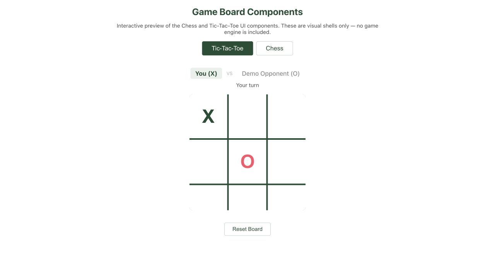

# Online Multiplayer Game Platform

A SENG 300 group project at the University of Calgary. Players sign in, join
lobbies, and play live turn-based matches.



The screenshot shows the local board preview, not a live multiplayer session.

## Architecture

React handles the interface, FastAPI handles accounts and game actions, and
MongoDB stores user data. Active matches and lobbies stay in server memory.

## Run

Requires Python 3.11+, Node.js 20+, and MongoDB. Use Chrome, Firefox, or Edge.

1. Start MongoDB and create a root `.env` with `SECRET_KEY`, `MONGODB_URL`, and
   `DB_NAME`. Generate your own secret and keep `.env` out of Git.
2. Install and start the backend (macOS/Linux):

```sh
python3 -m venv .venv
source .venv/bin/activate
pip install -r requirements.txt
PYTHONPATH=src python -m uvicorn app.main:app --reload --host 127.0.0.1 --port 8000
```

3. Start the frontend in another terminal:

```sh
cd frontend
npm install
npm start
```

Open [localhost:3000](http://localhost:3000).
See the [setup guide](docs/LOCAL_DEPLOYMENT_AND_VIDEO.md) for environment values
and Windows instructions.

## Tests

Run backend tests with `PYTHONPATH=src python -m pytest src/app/test -q`.
Run frontend tests with `npm test -- --watchAll=false` from `frontend/`.

Use one backend worker. Restarting it clears open lobbies and active games.
