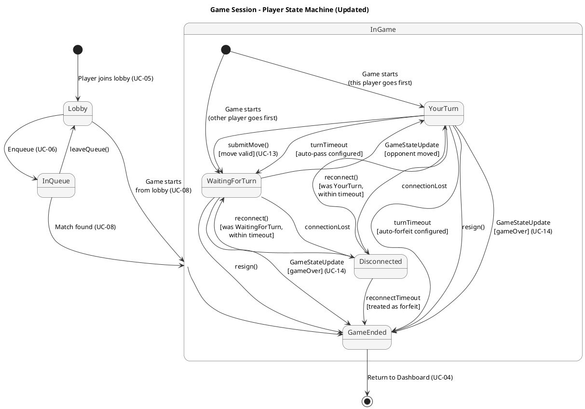

# Game Session State Diagram (Updated) #

## Changes from Quality Feedback ##

- **S-1**: Added `Disconnected` state with reconnection/forfeit transitions
- **S-2**: Added timeout transition from `YourTurn` → auto-forfeit/auto-pass
- **S-3**: Added resign transitions from `YourTurn` and `WaitingForTurn`

## State Diagram ##

For use in [editor.plantuml.com](editor.plantuml.com):

---

## State Descriptions ##

| State | Description |
|---|---|
| **Lobby** | Player is in a game lobby, chatting and waiting to start or enqueue. |
| **InQueue** | Player is in the matchmaking queue waiting for a match. |
| **YourTurn** | It is this player's turn. The turn timer is active. |
| **WaitingForTurn** | The opponent is making their move. Player input is disabled. |
| **Disconnected** | Player lost connection mid-game. A reconnection timer starts. If the player reconnects before the timer expires, they return to their previous state. If the timer expires, this is treated as a forfeit. |
| **GameEnded** | The game has concluded (win, draw, forfeit, resign, or timeout forfeit). Results are displayed via UC-14. |

## Transition Details ##

| Transition | Trigger | Guard / Notes |
|---|---|---|
| YourTurn → WaitingForTurn | `submitMove()` | Move is valid; state update broadcast via EventBus |
| YourTurn → WaitingForTurn | `turnTimeout` | Only when game rules specify auto-pass (e.g., pass turn) |
| YourTurn → GameEnded | `turnTimeout` | Only when game rules specify auto-forfeit |
| YourTurn → GameEnded | `resign()` | Player voluntarily resigns; recorded as a loss |
| WaitingForTurn → YourTurn | `GameStateUpdate` | Opponent's move received via EventBus |
| WaitingForTurn → GameEnded | `resign()` | Player resigns while waiting; recorded as a loss |
| YourTurn → Disconnected | `connectionLost` | Network failure detected |
| WaitingForTurn → Disconnected | `connectionLost` | Network failure detected |
| Disconnected → YourTurn | `reconnect()` | Reconnection within timeout; player's previous state was YourTurn |
| Disconnected → WaitingForTurn | `reconnect()` | Reconnection within timeout; previous state was WaitingForTurn |
| Disconnected → GameEnded | `reconnectTimeout` | Timeout expires (configurable, e.g., 120s); treated as forfeit |
| YourTurn/WaitingForTurn → GameEnded | `GameStateUpdate(gameOver)` | Win/draw condition detected by GameEngine |
