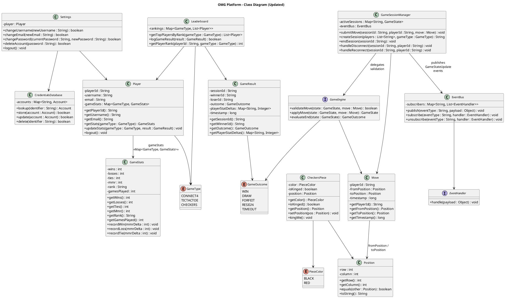

# Class Diagram Updates #

## Changes from Quality Feedback ##

- **C-1**: Aligned `Settings.logout()` and `Player.logout()` return types (both return `void`)
- **C-2**: Added `Map<GameType, GameStats>` to Player for per-game stat storage
- **C-3**: Fully defined `Move`, `Position`, and `CheckersPiece` classes with attributes
- **C-4**: Updated `submitMove()` to route through EventBus; expanded `logGameResult()` signature

## Updated Class Diagram ##

For use in [editor.plantuml.com](editor.plantuml.com):

---

## Change Summary ##

### C-1: Logout Return Type Consistency ###

| Class | Before | After |
|---|---|---|
| `Player.logout()` | `boolean` | `void` |
| `Settings.logout()` | `String` | `void` |

Both now return `void`. Errors during logout (e.g., cleanup failure) are handled via exceptions rather than return values, since a failed logout should not leave the user in an ambiguous state.

### C-2: Game Stats Storage ###

Added to `Player`:
- Attribute: `gameStats : Map<GameType, GameStats>`
- Method: `getStats(gameType : GameType) : GameStats` — performs map lookup
- Method: `updateStats(gameType : GameType, result : GameResult) : void` — delegates to the appropriate `GameStats` instance

New class `GameStats` encapsulates per-game statistics with `recordWin()`, `recordLoss()`, `recordTie()` methods that also apply MMR deltas.

### C-3: Incomplete Class Definitions ###

| Class | Attributes Added |
|---|---|
| `Move` | `playerId : String`, `fromPosition : Position`, `toPosition : Position`, `timestamp : long` |
| `Position` | `row : int`, `column : int` |
| `CheckersPiece` | `color : PieceColor`, `isKinged : boolean`, `position : Position` |

### C-4: submitMove Flow + logGameResult Completeness ###

**submitMove()**: `GameSessionManager.submitMove()` now publishes ALL results through `EventBus.publish()`:
- Valid move → publishes `GameStateUpdate` with new board state
- Invalid move → publishes `GameStateUpdate` with error
- Game over → publishes `GameStateUpdate(gameOver)` with result

No direct return values or callbacks are used — the GUI subscribes to EventBus events.

**logGameResult()**: Signature changed from `logGameResult(sessionId)` to `logGameResult(result : GameResult)` where `GameResult` contains `sessionId`, `winnerId`, `loserId`, `outcome` (WIN/DRAW/FORFEIT/RESIGN/TIMEOUT), and `playerStatDeltas`.
