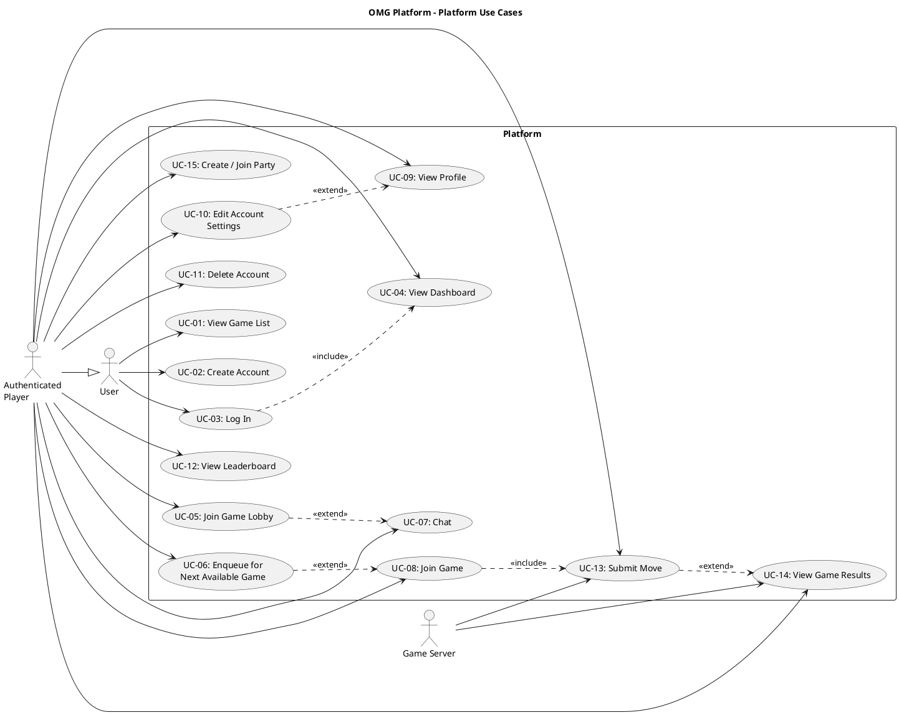

# Platform Use Case Descriptions #

## Use Case Diagram ##

For use in [editor.plantuml.com](editor.plantuml.com), SVG also attached:

---

## About ##

A use case diagram shows what a system does from the user's perspective, not how it is implemented.

### Purpose ##

Identify who interacts with the system (actors).
Define what goals those actors can accomplish (use cases).
Clarify the system boundary — what is inside the system and what is external.
Provide a shared, high-level understanding for stakeholders (developers, instructors, clients).
Serve as a starting point for requirements, user stories, and test scenarios.

### What it avoids ###

Internal logic, algorithms, data structures.
Execution order or control flow.
UI design details.

### Summary ###

A use case diagram answers "Who can do what with this system?" and is used to scope and validate requirements before design or implementation begins.

---

## UC-01: View Game List ##

| Field | Detail |
|---|---|
| **Primary Actor** | User |
| **Goal** | See available games (browse-only) |
| **Preconditions** | None (no authentication required) |
| **Trigger** | User visits the welcome page |
| **Postconditions** | None (no session created) |

**Main Success Scenario:**

1. User navigates to the welcome/landing page.
2. System retrieves the list of available games.
3. System displays the game list with basic info (name, description, player count).
4. User optionally selects a game to view more details.

**Alternative Flows:**

- **4a.** User selects a game → System displays a detail panel with game rules and current player counts.
- **4b.** User does not select a game → Use case ends.

**Exceptions:**

- **2a.** No games are available → System displays an appropriate message ("No games available at this time").

---

## UC-02: Create Account ##

| Field | Detail |
|---|---|
| **Primary Actor** | User |
| **Goal** | Register a new account |
| **Preconditions** | User does not already have an account (or chooses to create a new one) |
| **Trigger** | User selects "Create account" |
| **Postconditions** | Account exists; user is authenticated if auto-login is used |

**Main Success Scenario:**

1. System displays the registration form.
2. User enters required details (username, email, password).
3. System validates input (format rules, required fields, password strength).
4. System checks that the username/email is not already taken.
5. System stores the new account in the User Store.
6. System confirms account creation and optionally signs the user in.
7. If auto-login: system navigates to the dashboard (see UC-04).

**Alternative Flows:**

- **3a.** Input validation fails → System highlights the invalid fields with error messages; user corrects and resubmits.
- **4a.** Username/email already taken → System informs the user; user enters a different identifier.
- **7a.** Auto-login disabled → System navigates to the login page.

**Exceptions:**

- **5a.** User Store is unavailable → System displays a generic error message ("Unable to create account, please try again").

---

## UC-03: Log In ##

| Field | Detail |
|---|---|
| **Primary Actor** | User |
| **Goal** | Authenticate and access dashboard features |
| **Preconditions** | User has a registered account |
| **Trigger** | User selects "Log in" |
| **Postconditions** | User is authenticated |

**Main Success Scenario:**

1. System displays the login form.
2. User enters credentials (username/email + password).
3. System validates that fields are not empty.
4. System looks up the account in the User Store.
5. System verifies the password.
6. System establishes an authenticated session.
7. System displays the dashboard (UC-04).

**Alternative Flows:**

- **3a.** Empty fields → System displays inline validation errors; user fills in missing fields.

**Exceptions:**

- **4a.** Account not found → System displays "Invalid credentials" (generic to avoid enumeration).
- **5a.** Password incorrect → System displays "Invalid credentials".
- **5b.** Account is locked/disabled → System displays "Account unavailable, contact support".

---

## UC-04: View Dashboard ##

| Field | Detail |
|---|---|
| **Primary Actor** | Authenticated Player |
| **Goal** | Access authenticated options (lobby, queue, chat, join game when ready) |
| **Preconditions** | Player is authenticated |
| **Trigger** | Player logs in or navigates to the dashboard |
| **Postconditions** | None |

**Main Success Scenario:**

1. System retrieves the player's current status (idle, in lobby, in queue, game ready).
2. System displays the dashboard with available options:
   - Browse games
   - Join a game lobby
   - Enqueue for a game
   - Open chat
   - Join game (if a game is ready)
3. System displays any pending notifications (game invites, queue updates).
4. Player selects an action, triggering the corresponding use case.

**Alternative Flows:**

- **1a.** Player has "game ready" status → System highlights the "Join Game" option prominently.
- **1b.** Player is currently in a queue → System shows queue status and a "Leave Queue" option.
- **1c.** Player is in a lobby → System shows lobby info and a "Return to Lobby" option.

---

## UC-05: Join Game Lobby ##

| Field | Detail |
|---|---|
| **Primary Actor** | Authenticated Player |
| **Goal** | Enter a lobby for a specific game to coordinate and chat |
| **Preconditions** | Player is authenticated; target game exists |
| **Trigger** | Player selects a game and chooses "Join lobby" |
| **Postconditions** | Player is in the selected lobby |

**Main Success Scenario:**

1. System displays available lobbies for the selected game (or creates a new one if none exist).
2. Player selects a lobby (or is auto-assigned).
3. System adds the player to the lobby.
4. System displays lobby participants and lobby chat.
5. Player can send/receive messages (extends to UC-07: Chat).

**Alternative Flows:**

- **1a.** No open lobbies → System creates a new lobby and places the player in it.
- **2a.** Selected lobby is full → System notifies the player and suggests other lobbies or creates a new one.

**Exceptions:**

- **3a.** Player is already in another lobby → System prompts the player to leave the current lobby first.

---

## UC-06: Enqueue for Next Available Game ##

| Field | Detail |
|---|---|
| **Primary Actor** | Authenticated Player |
| **Goal** | Wait to be matched/assigned into the next available game session |
| **Preconditions** | Player is authenticated; game supports queueing |
| **Trigger** | Player selects "Enqueue" from the dashboard (optionally choosing a game) |
| **Postconditions** | Player is either still queued or has a "game ready" status |

**Main Success Scenario:**

1. Player optionally selects a specific game type to queue for.
2. System validates that the player is not already in an active game or queue.
3. System places the player into the matchmaking queue.
4. System displays queue status (position, estimated wait time if applicable).
5. When a session is available, the system notifies the player that the game is ready.
6. Player proceeds to UC-08: Join Game.

**Alternative Flows:**

- **1a.** Player does not select a game → System queues for any available game.
- **4a.** Player chooses to leave the queue → System removes the player; returns to dashboard.

**Exceptions:**

- **2a.** Player is already in a queue → System informs the player and offers to leave the current queue.
- **2b.** Player is in an active game → System blocks enqueue and informs the player.

---

## UC-07: Chat ##

| Field | Detail |
|---|---|
| **Primary Actor** | Authenticated Player |
| **Goal** | Send/receive chat messages (in a lobby or global context) |
| **Preconditions** | Player is authenticated |
| **Trigger** | Player opens the chat UI (from dashboard or lobby) |
| **Postconditions** | Chat history updated |

**Main Success Scenario:**

1. System displays the chat interface for the current context (lobby chat or global chat).
2. System loads recent chat history.
3. Player enters a message and submits.
4. System broadcasts the message to the appropriate channel/context.
5. Player receives messages from other participants in real time.

**Alternative Flows:**

- **1a.** Player is in a lobby → Chat defaults to the lobby channel.
- **1b.** Player is on the dashboard → Chat defaults to the global/general channel.
- **3a.** Player sends an empty message → System ignores the submission.

**Exceptions:**

- **4a.** Message delivery fails → System displays an error indicator next to the message.

---

## UC-08: Join Game ##

| Field | Detail |
|---|---|
| **Primary Actor** | Authenticated Player |
| **Goal** | Enter the active game session once it starts |
| **Preconditions** | Player is authenticated; a game session is available for the player (invited/matched/ready) |
| **Trigger** | Player selects "Join game" after being notified or seeing "game ready" |
| **Postconditions** | Player is in an active game session |

**Main Success Scenario:**

1. System verifies the player is assigned to the session.
2. System connects the player to the game session.
3. System loads the current game state.
4. System displays the game board/interface.
5. Player begins playing (further interactions handled by game-specific use cases).

**Alternative Flows:**

- **1a.** Player was notified via matchmaking (UC-06) → Session assignment already confirmed; proceed to step 2.
- **1b.** Player was in a lobby (UC-05) → System confirms lobby-to-session transition; proceed to step 2.

**Exceptions:**

- **1c.** Player is not assigned to the session → System displays "You are not part of this game session".
- **2a.** Game session no longer exists (expired/cancelled) → System informs the player and returns to dashboard.
- **2b.** Game session is already full → System informs the player and returns to dashboard.

---

## UC-09: View Profile ##

| Field | Detail |
|---|---|
| **Primary Actor** | Authenticated Player |
| **Goal** | View personal profile including stats, rank, and game history |
| **Preconditions** | Player is authenticated |
| **Trigger** | Player selects "View Profile" from the dashboard or navigation menu |
| **Postconditions** | None (read-only) |

**Main Success Scenario:**

1. System retrieves the player's profile data from the Player and PlayerStats objects.
2. System displays the profile view containing:
   - Username and email
   - Overall stats (games played, wins, losses, ties)
   - Per-game stats (Connect 4, Tic-Tac-Toe, Checkers)
   - Current rank and MMR for each game type
3. Player reviews their information.
4. Player navigates back to the dashboard.

**Alternative Flows:**

- **2a.** Player has no game history yet → System displays zeroed stats with a message ("No games played yet").
- **3a.** Player selects "Edit Settings" → System navigates to UC-10: Edit Account Settings.

**Exceptions:**

- **1a.** Player data fails to load → System displays "Unable to load profile, please try again".

---

## UC-10: Edit Account Settings ##

| Field | Detail |
|---|---|
| **Primary Actor** | Authenticated Player |
| **Goal** | Update account details (username, email, or password) |
| **Preconditions** | Player is authenticated |
| **Trigger** | Player selects "Settings" or "Edit Profile" from the profile page or dashboard |
| **Postconditions** | Updated fields are persisted in the CredentialsDatabase |

**Main Success Scenario:**

1. System displays the settings form pre-populated with the player's current username and email (password field blank).
2. Player modifies one or more fields.
3. System validates the new values:
   - Username: not empty, not already taken.
   - Email: valid format.
   - Password: meets minimum strength rules, requires current password confirmation.
4. System updates the corresponding fields via the Settings class (`changeUsername`, `changeEmail`, `changePassword`).
5. System persists changes to the CredentialsDatabase.
6. System confirms the update with a success message.

**Alternative Flows:**

- **2a.** Player only changes username → Steps 3–6 apply only to the username field.
- **2b.** Player only changes email → Steps 3–6 apply only to the email field.
- **2c.** Player only changes password → System requires the current password before accepting the new one.
- **3a.** Validation fails → System displays specific errors for each invalid field; player corrects and resubmits.

**Exceptions:**

- **3b.** New username already taken → System displays "Username is already in use".
- **3c.** Current password incorrect (when changing password) → System displays "Current password is incorrect".
- **5a.** CredentialsDatabase write fails → System displays "Unable to save changes, please try again".

---

## UC-11: Delete Account ##

| Field | Detail |
|---|---|
| **Primary Actor** | Authenticated Player |
| **Goal** | Permanently delete the player's account and all associated data |
| **Preconditions** | Player is authenticated |
| **Trigger** | Player selects "Delete Account" from the settings page |
| **Postconditions** | Account is removed from the CredentialsDatabase; player is logged out |

**Main Success Scenario:**

1. System displays a confirmation dialog ("Are you sure? This action cannot be undone.").
2. Player confirms the deletion.
3. System prompts the player to enter their password for verification.
4. Player enters their current password.
5. System verifies the password.
6. System calls `Settings.deleteAccount(password)` to remove the player from the CredentialsDatabase.
7. System clears the authenticated session.
8. System navigates to the welcome/login page with a confirmation message ("Your account has been deleted").

**Alternative Flows:**

- **2a.** Player cancels → Use case ends; player remains on the settings page.

**Exceptions:**

- **5a.** Password incorrect → System displays "Password is incorrect"; deletion is aborted.
- **6a.** Player is in an active game → System displays "You cannot delete your account while in an active game. Please finish or forfeit first."
- **6b.** CredentialsDatabase write fails → System displays "Unable to delete account, please try again".

---

## UC-12: View Leaderboard ##

| Field | Detail |
|---|---|
| **Primary Actor** | Authenticated Player |
| **Goal** | View the top-ranked players for a specific game type |
| **Preconditions** | Player is authenticated |
| **Trigger** | Player selects "Leaderboard" from the dashboard or navigation menu |
| **Postconditions** | None (read-only) |

**Main Success Scenario:**

1. System displays a game-type selector (Connect 4, Tic-Tac-Toe, Checkers, or Overall).
2. Player selects a game type.
3. System calls `Leaderboard.getTopPlayersByRank(gameType)` to retrieve rankings.
4. System displays the leaderboard table:
   - Rank position
   - Player username
   - Rank tier (Bronze, Silver, Gold, etc.)
   - MMR score
   - Win/loss record
5. Player's own position is highlighted if they appear on the board.

**Alternative Flows:**

- **2a.** Player selects "Overall" → System aggregates rankings across all game types.
- **5a.** Player is not ranked yet → System displays a note ("Play more games to appear on the leaderboard").

**Exceptions:**

- **3a.** No leaderboard data available → System displays "No rankings available yet".

---

## UC-13: Submit Move ##

| Field | Detail |
|---|---|
| **Primary Actor** | Authenticated Player |
| **Secondary Actor** | Game Server (GameSessionManager) |
| **Goal** | Make a move during an active game session |
| **Preconditions** | Player is authenticated; player is in an active game session; it is the player's turn |
| **Trigger** | Player performs a game action (clicks a board cell, selects a piece, etc.) |
| **Postconditions** | Game state is updated; turn passes to the next player or the game ends |

**Main Success Scenario:**

1. System displays the game board with the player's available actions (it is the player's turn — `YourTurn` state).
2. Player selects a move (e.g., places a piece, moves a checker).
3. System sends the move to `GameSessionManager.submitMove(sessionId, playerId, move)`.
4. GameSessionManager delegates to `GameEngine.validateMove(state, move)`.
5. Move is valid — GameSessionManager calls `GameEngine.applyMove(state, move)`.
6. GameSessionManager calls `GameEngine.evaluateEnd(state)` to check for win/draw.
7. Game is not over — GameSessionManager emits a `GameStateUpdate` event (status: opponent's turn).
8. System updates the board display for all players.
9. Player's state transitions to `WaitingForTurn`.

**Alternative Flows:**

- **6a.** Game is over (win or draw) → GameSessionManager emits `GameStateUpdate(gameOver)`; triggers UC-14: View Game Results.

**Exceptions:**

- **4a.** Move is invalid → GameSessionManager emits `GameStateUpdate` with error; system displays "Invalid move" and keeps the player in `YourTurn` state to retry.
- **1a.** It is not the player's turn (`WaitingForTurn` state) → Input is disabled; player must wait for their turn notification.
- **3a.** Session no longer exists → System displays "Game session ended" and returns to dashboard.

---

## UC-14: View Game Results ##

| Field | Detail |
|---|---|
| **Primary Actor** | Authenticated Player |
| **Secondary Actor** | Game Server (GameSessionManager, Leaderboard) |
| **Goal** | See the outcome of a completed game and updated stats |
| **Preconditions** | A game session the player was in has ended (`GameEnded` state) |
| **Trigger** | `GameStateUpdate(gameOver)` is received (automatic after UC-13 detects end condition) |
| **Postconditions** | Player stats and leaderboard are updated |

**Main Success Scenario:**

1. System receives the `GameStateUpdate(gameOver)` event with the result payload.
2. System displays the game results screen:
   - Winner / draw indication
   - Final board state
   - Player stats changes (MMR gained/lost, new rank if applicable)
3. System calls `Leaderboard.logGameResult(sessionId)` to persist the outcome.
4. System updates each player's `GeneralStats` (win/lose/tie, MMR, rank).
5. Player reviews results.
6. Player selects "Return to Dashboard" → System navigates to UC-04.

**Alternative Flows:**

- **2a.** Player was disconnected when game ended → Results are stored; when the player reconnects, the results screen is shown.
- **5a.** Player selects "Play Again" (if supported) → System enqueues the player for the same game type (UC-06).
- **5b.** Player selects "View Leaderboard" → System navigates to UC-12.

**Exceptions:**

- **3a.** Leaderboard service fails → Results are still displayed to the player; stat persistence is retried or logged for manual reconciliation.

---

## UC-15: Create / Join Party ##

| Field | Detail |
|---|---|
| **Primary Actor** | Authenticated Player |
| **Goal** | Form a pre-made group with friends to queue or play together |
| **Preconditions** | Player is authenticated |
| **Trigger** | Player selects "Create Party" or "Join Party" from the dashboard |
| **Postconditions** | Player is in a party; party members can queue together |

**Main Success Scenario (Create Party):**

1. Player selects "Create Party".
2. System calls `PartySystem.createParty()` and generates a unique party ID.
3. System displays the party lobby with the party ID (shareable with friends).
4. System shows the player as the party leader.
5. Other players join using the party ID (see Join Party flow below).
6. Once all members are ready, the leader can enqueue the party (UC-06).

**Main Success Scenario (Join Party):**

1. Player selects "Join Party".
2. System prompts for a party ID.
3. Player enters the party ID.
4. System calls `PartySystem.joinParty(partyId, playerId)`.
5. System adds the player to the party lobby.
6. System updates the party view for all members.

**Alternative Flows:**

- **5a.** (Create) No one joins → Leader can still enqueue solo or disband the party.
- **6a.** (Create) Party leader enqueues → All party members are placed into the matchmaking queue together.

**Exceptions:**

- **4a.** (Join) Party ID does not exist → System displays "Party not found".
- **4b.** (Join) Party is full → System displays "Party is full".
- **4c.** (Join) Player is already in another party → System prompts the player to leave their current party first.
