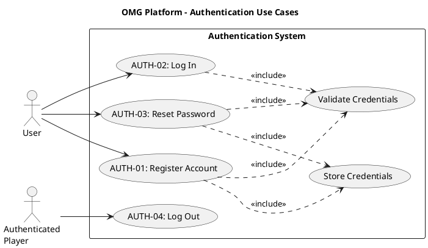

# Authentication Use Case Descriptions #

## Use Case Diagram ##

For use in [editor.plantuml.com](editor.plantuml.com), SVG also attached:

---

## AUTH-01: Register Account ##

| Field | Detail |
|---|---|
| **Primary Actor** | User |
| **Goal** | Create a new account that can be used to log in later |
| **Preconditions** | User is not currently authenticated |
| **Trigger** | User selects "Register" |
| **Postconditions** | Account exists in the User Store Stub |

**Main Success Scenario:**

1. System displays the registration form.
2. User enters required fields (username/email + password).
3. System validates input (format rules, required fields).
4. System checks that the identifier (username/email) is not already taken.
5. System stores the new account in the User Store Stub (HashMap or file).
6. System confirms registration (optionally logs the user in).

**Alternative Flows:**

- **3a.** Input format invalid (e.g., password too short) → System displays specific validation errors; user corrects and resubmits.
- **4a.** Username/email already taken → System informs the user; user enters a different identifier.
- **6a.** Auto-login enabled → System creates an authenticated session and navigates to the dashboard.
- **6b.** Auto-login disabled → System displays a success message and navigates to the login page.

**Exceptions:**

- **5a.** User Store Stub write fails (file I/O error) → System displays a generic error; user may retry.

**Notes for stub implementation:**
- HashMap version: in-memory persistence for the run.
- File version: load at startup, save after registration.

---

## AUTH-02: Log In ##

| Field | Detail |
|---|---|
| **Primary Actor** | User |
| **Goal** | Authenticate to access protected features |
| **Preconditions** | User has a registered account in the User Store Stub |
| **Trigger** | User selects "Log in" |
| **Postconditions** | User is authenticated |

**Main Success Scenario:**

1. System displays the login form.
2. User enters identifier (username/email) + password.
3. System looks up the account in the User Store Stub.
4. System verifies the password.
5. System creates an authenticated session (or marks user as "logged in").
6. System navigates to the dashboard / authenticated landing page.

**Alternative Flows:**

- **2a.** User selects "Forgot password" instead → redirect to AUTH-03: Reset Password.
- **2b.** User selects "Register" instead → redirect to AUTH-01: Register Account.

**Exceptions:**

- **3a.** Account not found → System displays "Invalid credentials" (generic message to prevent enumeration).
- **4a.** Password does not match → System displays "Invalid credentials".
- **3b.** User Store Stub unavailable → System displays "Service unavailable, please try again".

**Notes for stub implementation:**
- Session can be a simple in-memory variable (e.g., `currentUser`).

---

## AUTH-03: Reset Password ##

| Field | Detail |
|---|---|
| **Primary Actor** | User |
| **Goal** | Replace a forgotten password with a new one |
| **Preconditions** | User is not authenticated (typical), OR is authenticated and wants to change password (optional variant) |
| **Trigger** | User selects "Forgot password" (or "Reset password") |
| **Postconditions** | Stored password is updated |

**Main Success Scenario (stub-friendly):**

1. System asks for an identifier (username/email).
2. User enters their identifier.
3. System verifies the account exists in the User Store Stub.
4. System verifies reset authorization using a simplified method (see options below).
5. User enters a new password.
6. System validates the new password against password rules (minimum length, etc.).
7. System updates the stored password in the User Store Stub.
8. System confirms the reset and navigates to the login page.

**Alternative Flows:**

- **4a.** Security question method → System displays the stored security question; user provides the answer; system verifies.
- **4b.** Email simulation method → System displays a one-time code on screen; user enters the code; system verifies.
- **6a.** New password does not meet rules → System displays validation errors; user enters a different password.

**Exceptions:**

- **3a.** Account not found → System displays "No account found with that identifier".
- **4c.** Authorization fails (wrong answer / wrong code) → System displays "Verification failed"; user may retry.
- **7a.** User Store Stub write fails → System displays a generic error; user may retry.

**Choose one reset authorization method (simple for students):**

- Security question stored in stub (question + answer).
- "Email simulation": system displays a one-time code on screen (not realistic, but works for a stubbed environment).

---

## AUTH-04: Log Out ##

| Field | Detail |
|---|---|
| **Primary Actor** | Authenticated Player |
| **Goal** | End the authenticated session |
| **Preconditions** | Player is authenticated |
| **Trigger** | Player selects "Log out" |
| **Postconditions** | Player is not authenticated |

**Main Success Scenario:**

1. System clears the authenticated session (e.g., sets `currentUser = null`).
2. System cleans up any active state (leaves lobby, removes from queue if applicable).
3. System navigates to the welcome/login page.

**Alternative Flows:**

- **2a.** Player is currently in a game → System prompts "You are in an active game. Logging out will forfeit. Continue?" → Player confirms → System forfeits the game, then logs out.
- **2b.** Player is in a queue → System silently removes them from the queue before logging out.

**Exceptions:**

- None anticipated for a stub implementation.
