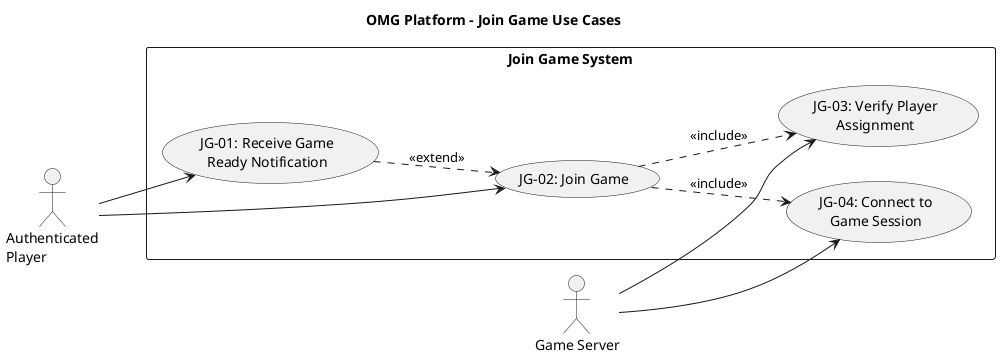

# Join Game Use Case Descriptions #

## Use Case Diagram ##

For use in [editor.plantuml.com](editor.plantuml.com), SVG also attached:

---

## JG-01: Receive Game Ready Notification ##

| Field | Detail |
|---|---|
| **Primary Actor** | Authenticated Player |
| **Goal** | Be notified that a game session is ready and the player can join |
| **Preconditions** | Player is authenticated; player is in a queue or lobby where a game is being assembled |
| **Trigger** | Matchmaking system or lobby coordinator finds enough players for a session |
| **Postconditions** | Player is aware a game is ready; "Join Game" action is available |

**Main Success Scenario:**

1. Matchmaking system assembles a valid game session (minimum players reached).
2. System sends a "Game Ready" notification to the player.
3. System updates the player's dashboard status to "Game Ready".
4. System displays a prompt or button allowing the player to join.
5. Player proceeds to JG-02: Join Game (extends).

**Alternative Flows:**

- **4a.** Player is currently on the dashboard → Notification appears as a prominent banner or modal.
- **4b.** Player is in a lobby → Notification appears inline in the lobby UI.
- **5a.** Player does not respond within the timeout window → System may cancel the player's spot and return them to the queue or lobby.

**Exceptions:**

- **2a.** Player has disconnected → System holds the spot for a grace period; if player reconnects, notification is re-delivered.

---

## JG-02: Join Game ##

| Field | Detail |
|---|---|
| **Primary Actor** | Authenticated Player |
| **Goal** | Enter the active game session once it starts |
| **Preconditions** | Player is authenticated; a game session is available for the player (invited/matched/ready) |
| **Trigger** | Player selects "Join Game" after receiving notification or seeing "game ready" status |
| **Postconditions** | Player is in an active game session |

**Main Success Scenario:**

1. Player selects "Join Game".
2. System invokes JG-03: Verify Player Assignment (<<include>>).
3. Verification succeeds.
4. System invokes JG-04: Connect to Game Session (<<include>>).
5. Connection succeeds.
6. System loads the current game state (board, turn info, players).
7. System displays the game interface.
8. Player begins playing.

**Alternative Flows:**

- **1a.** Player was auto-joined (lobby-based game) → Steps 1 is implicit; system proceeds directly to verification.

**Exceptions:**

- **3a.** Verification fails (player not assigned) → System displays "You are not part of this game session"; returns to dashboard.
- **5a.** Connection fails (session expired or cancelled) → System displays "Game session is no longer available"; returns to dashboard.
- **5b.** Connection fails (session is full) → System displays "Game session is already full"; returns to dashboard.

---

## JG-03: Verify Player Assignment ##

| Field | Detail |
|---|---|
| **Primary Actor** | Game Server |
| **Goal** | Confirm that the player is a valid participant in the game session |
| **Preconditions** | A game session exists; a player is attempting to join |
| **Trigger** | Included by JG-02: Join Game |
| **Postconditions** | Player's assignment is confirmed or rejected |

**Main Success Scenario:**

1. System receives the player ID and session ID.
2. System looks up the session's assigned player list.
3. System confirms the player is in the assigned list.
4. System returns a success status to the calling use case.

**Alternative Flows:**

- **3a.** Player was assigned via matchmaking → System checks the matchmaking assignment records.
- **3b.** Player was assigned via lobby → System checks the lobby-to-session mapping.

**Exceptions:**

- **3c.** Player is not in the assigned list → System returns a failure status with reason "Player not assigned".
- **2a.** Session does not exist → System returns a failure status with reason "Session not found".

---

## JG-04: Connect to Game Session ##

| Field | Detail |
|---|---|
| **Primary Actor** | Game Server |
| **Goal** | Establish a connection between the player and the active game session |
| **Preconditions** | Player assignment has been verified (JG-03 passed); game session is active |
| **Trigger** | Included by JG-02: Join Game (after successful verification) |
| **Postconditions** | Player is connected to the game session and can send/receive game events |

**Main Success Scenario:**

1. System registers the player as an active participant in the session.
2. System subscribes the player to the session's event stream (GameStateUpdate events).
3. System sends the current game state snapshot to the player.
4. System notifies other participants that the player has joined.
5. System returns a success status to the calling use case.

**Alternative Flows:**

- **1a.** Player is reconnecting after a disconnect → System restores the player's previous state instead of initializing fresh.
- **4a.** All expected players have now joined → System transitions the session to "ReadyToStart" or "Starting" state.

**Exceptions:**

- **1b.** Session has been cancelled while connecting → System returns a failure status with reason "Session cancelled".
- **1c.** Session is already at max capacity → System returns a failure status with reason "Session full".
