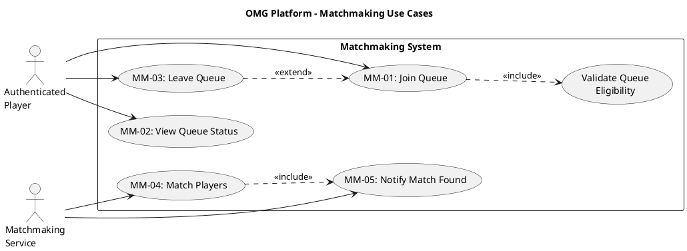

# Matchmaking Use Case Descriptions #

## Use Case Diagram ##

For use in [editor.plantuml.com](editor.plantuml.com):

---

## MM-01: Join Queue ##

| Field | Detail |
|---|---|
| **Primary Actor** | Authenticated Player |
| **Goal** | Enter the matchmaking queue to be paired with opponents |
| **Preconditions** | Player is authenticated; player is not already in a queue or active game |
| **Trigger** | Player selects "Enqueue" or "Find Game" from the dashboard or lobby |
| **Postconditions** | Player is placed in the matchmaking queue |

**Main Success Scenario:**

1. Player selects a game type to queue for (or "any").
2. System validates queue eligibility (<<include>>):
   - Player is not already in a queue.
   - Player is not in an active game session.
   - Selected game type exists and supports matchmaking.
3. System adds the player to the appropriate queue.
4. System confirms queue entry and displays initial queue status.
5. System begins periodic status updates (see MM-02).

**Alternative Flows:**

- **1a.** Player does not select a game type → System queues the player for any available game type.
- **4a.** Player is immediately matched (another player was already waiting) → System skips to MM-04 / MM-05; player receives a match notification.

**Exceptions:**

- **2a.** Player is already in a queue → System displays "You are already queued. Leave your current queue first."
- **2b.** Player is in an active game → System displays "You cannot queue while in an active game."
- **2c.** Game type does not exist or is disabled → System displays "This game is not currently available for matchmaking."

---

## MM-02: View Queue Status ##

| Field | Detail |
|---|---|
| **Primary Actor** | Authenticated Player |
| **Goal** | See current position and estimated wait time in the queue |
| **Preconditions** | Player is authenticated and currently in a queue |
| **Trigger** | Player navigates to the dashboard or queue status panel while queued |
| **Postconditions** | None (informational only) |

**Main Success Scenario:**

1. System retrieves the player's current queue information.
2. System displays:
   - Game type queued for.
   - Position in queue (if applicable).
   - Estimated wait time (if applicable).
   - Number of players currently in queue.
3. System updates the display periodically or on status change.

**Alternative Flows:**

- **3a.** Match is found while viewing status → Display transitions to "Match Found!" with a join prompt.

**Exceptions:**

- **1a.** Player is no longer in a queue (e.g., was removed due to timeout) → System displays "You are no longer in a queue" and returns to dashboard.

---

## MM-03: Leave Queue ##

| Field | Detail |
|---|---|
| **Primary Actor** | Authenticated Player |
| **Goal** | Voluntarily exit the matchmaking queue before being matched |
| **Preconditions** | Player is authenticated and currently in a queue |
| **Trigger** | Player selects "Leave Queue" or "Cancel" |
| **Postconditions** | Player is removed from the queue; status returns to idle |

**Main Success Scenario:**

1. Player selects "Leave Queue".
2. System removes the player from the matchmaking queue.
3. System confirms removal ("You have left the queue").
4. System updates the dashboard to reflect idle status.

**Alternative Flows:**

- **1a.** Player navigates away from the queue screen → System may prompt "Leave queue?" or keep them queued in the background (design decision).
- **1b.** Player initiates logout → System automatically removes them from the queue as part of the logout process (see AUTH-04).

**Exceptions:**

- **2a.** Match was found at the same moment → System prioritizes the match; player receives the match notification instead of leaving.

---

## MM-04: Match Players ##

| Field | Detail |
|---|---|
| **Primary Actor** | Matchmaking Service |
| **Goal** | Assemble a valid group of players for a game session |
| **Preconditions** | Queue has enough players to form a session for at least one game type |
| **Trigger** | A new player joins the queue, or periodic queue evaluation runs |
| **Postconditions** | A group of players is matched and a game session is created |

**Main Success Scenario:**

1. Matchmaking Service evaluates the queue(s).
2. Service identifies enough players for a game session (e.g., 2 for Checkers/Connect 4/Tic-Tac-Toe).
3. Service removes matched players from the queue.
4. Service creates a new game session and assigns the matched players to it.
5. Service invokes MM-05: Notify Match Found (<<include>>) for each matched player.

**Alternative Flows:**

- **2a.** Players queued for "any" game type → Service assigns them to the game type with the shortest wait.
- **2b.** Not enough players for any game type → Service waits; no match is made this cycle.

**Exceptions:**

- **3a.** A matched player disconnects before session creation → Service returns remaining players to the queue and retries.
- **4a.** Session creation fails → Service returns all matched players to the queue and logs the error.

---

## MM-05: Notify Match Found ##

| Field | Detail |
|---|---|
| **Primary Actor** | Matchmaking Service |
| **Goal** | Inform matched players that a game is ready |
| **Preconditions** | A match has been assembled (MM-04 succeeded); game session is created |
| **Trigger** | Included by MM-04: Match Players |
| **Postconditions** | All matched players are notified; players can proceed to join the game |

**Main Success Scenario:**

1. System sends a "Match Found" notification to each matched player.
2. System updates each player's status to "Game Ready".
3. System provides session details (game type, opponent names, session ID).
4. Players receive the notification on their current screen (dashboard, queue status, or lobby).
5. Players can now proceed to join the game (links to Platform UC-08 / JG-02).

**Alternative Flows:**

- **4a.** Player is on the dashboard → Notification appears as a modal or banner.
- **4b.** Player is viewing queue status → Status display transitions to "Match Found!" with a join button.
- **4c.** Player is in a lobby → Notification appears as an in-lobby alert.

**Exceptions:**

- **1a.** Player is unreachable (disconnected) → System holds the notification for a grace period. If the player reconnects, notification is delivered. If grace period expires, the player's spot may be reassigned (triggers partial re-match in MM-04).
