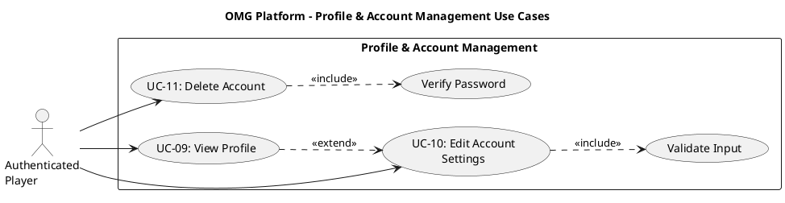

# Profile and Account Management Use Case Descriptions #

## Use Case Diagram ##

For use in [editor.plantuml.com](editor.plantuml.com), SVG also attached:

---

## UC-09: View Profile ##

| Field | Detail |
|---|---|
| **Primary Actor** | Authenticated Player |
| **Goal** | View personal profile including stats, rank, and game history |
| **Preconditions** | Player is authenticated |
| **Trigger** | Player selects "View Profile" from the dashboard or navigation menu |
| **Postconditions** | None (read-only) |

**Main Success Scenario:**

1. System retrieves the player's profile data from the Player and PlayerStats objects.
2. System displays the profile view containing:
   - Username and email
   - Overall stats (games played, wins, losses, ties)
   - Per-game stats (Connect 4, Tic-Tac-Toe, Checkers)
   - Current rank and MMR for each game type
3. Player reviews their information.
4. Player navigates back to the dashboard.

**Alternative Flows:**

- **2a.** Player has no game history yet → System displays zeroed stats with a message ("No games played yet").
- **3a.** Player selects "Edit Settings" → System navigates to UC-10: Edit Account Settings.

**Exceptions:**

- **1a.** Player data fails to load → System displays "Unable to load profile, please try again".

---

## UC-10: Edit Account Settings ##

| Field | Detail |
|---|---|
| **Primary Actor** | Authenticated Player |
| **Goal** | Update account details (username, email, or password) |
| **Preconditions** | Player is authenticated |
| **Trigger** | Player selects "Settings" or "Edit Profile" from the profile page or dashboard |
| **Postconditions** | Updated fields are persisted in the CredentialsDatabase |

**Main Success Scenario:**

1. System displays the settings form pre-populated with the player's current username and email (password field blank).
2. Player modifies one or more fields.
3. System validates the new values:
   - Username: not empty, not already taken.
   - Email: valid format.
   - Password: meets minimum strength rules, requires current password confirmation.
4. System updates the corresponding fields via the Settings class (`changeUsername`, `changeEmail`, `changePassword`).
5. System persists changes to the CredentialsDatabase.
6. System confirms the update with a success message.

**Alternative Flows:**

- **2a.** Player only changes username → Steps 3–6 apply only to the username field.
- **2b.** Player only changes email → Steps 3–6 apply only to the email field.
- **2c.** Player only changes password → System requires the current password before accepting the new one.
- **3a.** Validation fails → System displays specific errors for each invalid field; player corrects and resubmits.

**Exceptions:**

- **3b.** New username already taken → System displays "Username is already in use".
- **3c.** Current password incorrect (when changing password) → System displays "Current password is incorrect".
- **5a.** CredentialsDatabase write fails → System displays "Unable to save changes, please try again".

---

## UC-11: Delete Account ##

| Field | Detail |
|---|---|
| **Primary Actor** | Authenticated Player |
| **Goal** | Permanently delete the player's account and all associated data |
| **Preconditions** | Player is authenticated |
| **Trigger** | Player selects "Delete Account" from the settings page |
| **Postconditions** | Account is removed from the CredentialsDatabase; player is logged out |

**Main Success Scenario:**

1. System displays a confirmation dialog ("Are you sure? This action cannot be undone.").
2. Player confirms the deletion.
3. System prompts the player to enter their password for verification.
4. Player enters their current password.
5. System verifies the password.
6. System calls `Settings.deleteAccount(password)` to remove the player from the CredentialsDatabase.
7. System clears the authenticated session.
8. System navigates to the welcome/login page with a confirmation message ("Your account has been deleted").

**Alternative Flows:**

- **2a.** Player cancels → Use case ends; player remains on the settings page.

**Exceptions:**

- **5a.** Password incorrect → System displays "Password is incorrect"; deletion is aborted.
- **6a.** Player is in an active game → System displays "You cannot delete your account while in an active game. Please finish or forfeit first."
- **6b.** CredentialsDatabase write fails → System displays "Unable to delete account, please try again".
