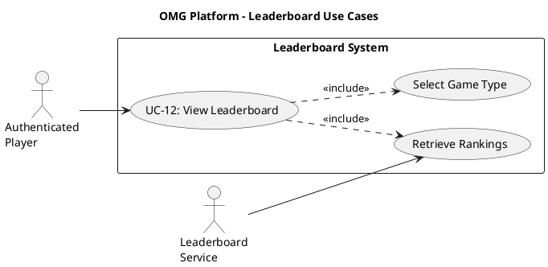

# Leaderboard Use Case Descriptions #

## Use Case Diagram ##

For use in [editor.plantuml.com](editor.plantuml.com), SVG also attached:

---

## UC-12: View Leaderboard ##

| Field | Detail |
|---|---|
| **Primary Actor** | Authenticated Player |
| **Secondary Actor** | Leaderboard Service |
| **Goal** | View the top-ranked players for a specific game type |
| **Preconditions** | Player is authenticated |
| **Trigger** | Player selects "Leaderboard" from the dashboard or navigation menu |
| **Postconditions** | None (read-only) |

**Main Success Scenario:**

1. System displays a game-type selector (Connect 4, Tic-Tac-Toe, Checkers, or Overall).
2. Player selects a game type.
3. System calls `Leaderboard.getTopPlayersByRank(gameType)` to retrieve rankings.
4. System displays the leaderboard table:
   - Rank position
   - Player username
   - Rank tier (Bronze, Silver, Gold, etc.)
   - MMR score
   - Win/loss record
5. Player's own position is highlighted if they appear on the board.

**Alternative Flows:**

- **2a.** Player selects "Overall" → System aggregates rankings across all game types.
- **5a.** Player is not ranked yet → System displays a note ("Play more games to appear on the leaderboard").

**Exceptions:**

- **3a.** No leaderboard data available → System displays "No rankings available yet".
