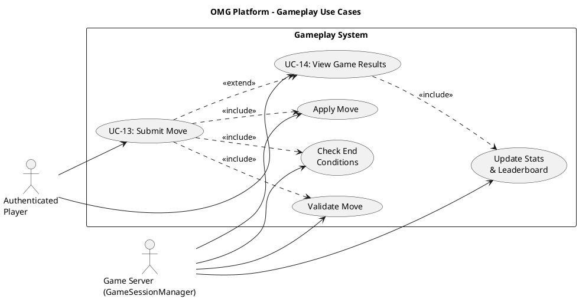

# Gameplay Use Case Descriptions #

## Use Case Diagram ##

For use in [editor.plantuml.com](editor.plantuml.com), SVG also attached:

---

## UC-13: Submit Move ##

| Field | Detail |
|---|---|
| **Primary Actor** | Authenticated Player |
| **Secondary Actor** | Game Server (GameSessionManager) |
| **Goal** | Make a move during an active game session |
| **Preconditions** | Player is authenticated; player is in an active game session; it is the player's turn |
| **Trigger** | Player performs a game action (clicks a board cell, selects a piece, etc.) |
| **Postconditions** | Game state is updated; turn passes to the next player or the game ends |

**Main Success Scenario:**

1. System displays the game board with the player's available actions (it is the player's turn — `YourTurn` state).
2. Player selects a move (e.g., places a piece, moves a checker).
3. System sends the move to `GameSessionManager.submitMove(sessionId, playerId, move)`.
4. GameSessionManager delegates to `GameEngine.validateMove(state, move)`.
5. Move is valid — GameSessionManager calls `GameEngine.applyMove(state, move)`.
6. GameSessionManager calls `GameEngine.evaluateEnd(state)` to check for win/draw.
7. Game is not over — GameSessionManager emits a `GameStateUpdate` event (status: opponent's turn).
8. System updates the board display for all players.
9. Player's state transitions to `WaitingForTurn`.

**Alternative Flows:**

- **6a.** Game is over (win or draw) → GameSessionManager emits `GameStateUpdate(gameOver)`; triggers UC-14: View Game Results.

**Exceptions:**

- **4a.** Move is invalid → GameSessionManager emits `GameStateUpdate` with error; system displays "Invalid move" and keeps the player in `YourTurn` state to retry.
- **1a.** It is not the player's turn (`WaitingForTurn` state) → Input is disabled; player must wait for their turn notification.
- **3a.** Session no longer exists → System displays "Game session ended" and returns to dashboard.

---

## UC-14: View Game Results ##

| Field | Detail |
|---|---|
| **Primary Actor** | Authenticated Player |
| **Secondary Actor** | Game Server (GameSessionManager, Leaderboard) |
| **Goal** | See the outcome of a completed game and updated stats |
| **Preconditions** | A game session the player was in has ended (`GameEnded` state) |
| **Trigger** | `GameStateUpdate(gameOver)` is received (automatic after UC-13 detects end condition) |
| **Postconditions** | Player stats and leaderboard are updated |

**Main Success Scenario:**

1. System receives the `GameStateUpdate(gameOver)` event with the result payload.
2. System displays the game results screen:
   - Winner / draw indication
   - Final board state
   - Player stats changes (MMR gained/lost, new rank if applicable)
3. System calls `Leaderboard.logGameResult(sessionId)` to persist the outcome.
4. System updates each player's `GeneralStats` (win/lose/tie, MMR, rank).
5. Player reviews results.
6. Player selects "Return to Dashboard" → System navigates to UC-04.

**Alternative Flows:**

- **2a.** Player was disconnected when game ended → Results are stored; when the player reconnects, the results screen is shown.
- **5a.** Player selects "Play Again" (if supported) → System enqueues the player for the same game type (UC-06).
- **5b.** Player selects "View Leaderboard" → System navigates to UC-12.

**Exceptions:**

- **3a.** Leaderboard service fails → Results are still displayed to the player; stat persistence is retried or logged for manual reconciliation.
