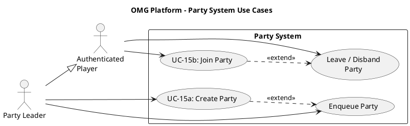

# Party System Use Case Descriptions #

## Use Case Diagram ##

For use in [editor.plantuml.com](editor.plantuml.com), SVG also attached:

---

## UC-15a: Create Party ##

| Field | Detail |
|---|---|
| **Primary Actor** | Authenticated Player (becomes Party Leader) |
| **Goal** | Form a pre-made group with friends to queue or play together |
| **Preconditions** | Player is authenticated; player is not already in a party |
| **Trigger** | Player selects "Create Party" from the dashboard |
| **Postconditions** | Player is in a party as the leader; party ID is available for sharing |

**Main Success Scenario:**

1. Player selects "Create Party".
2. System calls `PartySystem.createParty()` and generates a unique party ID.
3. System displays the party lobby with the party ID (shareable with friends).
4. System shows the player as the party leader.
5. Other players join using the party ID (see UC-15b).
6. Once all members are ready, the leader can enqueue the party (UC-06).

**Alternative Flows:**

- **5a.** No one joins → Leader can still enqueue solo or disband the party.
- **6a.** Party leader enqueues → All party members are placed into the matchmaking queue together.

**Exceptions:**

- **2a.** Player is already in a party → System displays "You are already in a party. Leave your current party first."

---

## UC-15b: Join Party ##

| Field | Detail |
|---|---|
| **Primary Actor** | Authenticated Player |
| **Goal** | Join an existing party created by another player |
| **Preconditions** | Player is authenticated; player is not already in a party |
| **Trigger** | Player selects "Join Party" from the dashboard |
| **Postconditions** | Player is a member of the party |

**Main Success Scenario:**

1. Player selects "Join Party".
2. System prompts for a party ID.
3. Player enters the party ID.
4. System calls `PartySystem.joinParty(partyId, playerId)`.
5. System adds the player to the party lobby.
6. System updates the party view for all members.

**Alternative Flows:**

- **6a.** All required players have joined → Party leader can now enqueue (UC-06).

**Exceptions:**

- **4a.** Party ID does not exist → System displays "Party not found".
- **4b.** Party is full → System displays "Party is full".
- **4c.** Player is already in another party → System prompts the player to leave their current party first.
