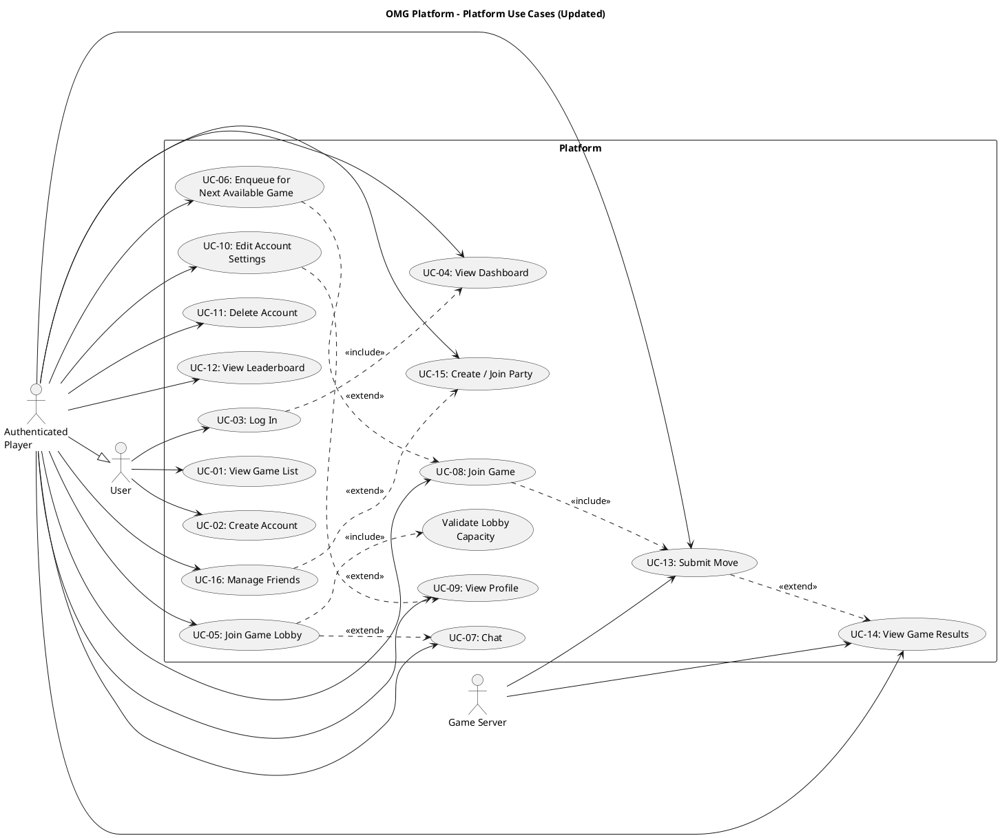

# Platform Use Case Diagram (Updated) #

## Changes from Quality Feedback ##

- **UC-2**: Added UC-16: Manage Friends
- **UC-3**: UC-05 now includes lobby capacity validation

## Use Case Diagram ##

For use in [editor.plantuml.com](editor.plantuml.com):

