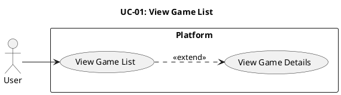

# UC-01: View Game List #

## Use Case Diagram ##

For use in [editor.plantuml.com](editor.plantuml.com), SVG also attached:

---

## Description ##

| Field | Detail |
|---|---|
| **Use Case ID** | UC-01 |
| **Primary Actor** | User |
| **Goal** | See available games (browse-only) |
| **Preconditions** | None (no authentication required) |
| **Trigger** | User visits the welcome page |
| **Postconditions** | None (no session created) |

**Main Success Scenario:**

1. User navigates to the welcome/landing page.
2. System retrieves the list of available games.
3. System displays the game list with basic info (name, description, player count).
4. User optionally selects a game to view more details.

**Alternative Flows:**

- **4a.** User selects a game → System displays a detail panel with game rules and current player counts.
- **4b.** User does not select a game → Use case ends.

**Exceptions:**

- **2a.** No games are available → System displays an appropriate message ("No games available at this time").
