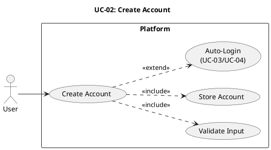

# UC-02: Create Account #

## Use Case Diagram ##

For use in [editor.plantuml.com](editor.plantuml.com), SVG also attached:

---

## Description ##

| Field | Detail |
|---|---|
| **Use Case ID** | UC-02 |
| **Primary Actor** | User |
| **Goal** | Register a new account |
| **Preconditions** | User does not already have an account (or chooses to create a new one) |
| **Trigger** | User selects "Create account" |
| **Postconditions** | Account exists; user is authenticated if auto-login is used |

**Main Success Scenario:**

1. System displays the registration form.
2. User enters required details (username, email, password).
3. System validates input (format rules, required fields, password strength).
4. System checks that the username/email is not already taken.
5. System stores the new account in the User Store.
6. System confirms account creation and optionally signs the user in.
7. If auto-login: system navigates to the dashboard (see UC-04).

**Alternative Flows:**

- **3a.** Input validation fails → System highlights the invalid fields with error messages; user corrects and resubmits.
- **4a.** Username/email already taken → System informs the user; user enters a different identifier.
- **7a.** Auto-login disabled → System navigates to the login page.

**Exceptions:**

- **5a.** User Store is unavailable → System displays a generic error message ("Unable to create account, please try again").
