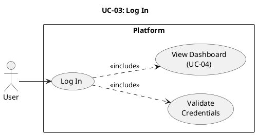

# UC-03: Log In #

## Use Case Diagram ##

For use in [editor.plantuml.com](editor.plantuml.com), SVG also attached:

---

## Description ##

| Field | Detail |
|---|---|
| **Use Case ID** | UC-03 |
| **Primary Actor** | User |
| **Goal** | Authenticate and access dashboard features |
| **Preconditions** | User has a registered account |
| **Trigger** | User selects "Log in" |
| **Postconditions** | User is authenticated |

**Main Success Scenario:**

1. System displays the login form.
2. User enters credentials (username/email + password).
3. System validates that fields are not empty.
4. System looks up the account in the User Store.
5. System verifies the password.
6. System establishes an authenticated session.
7. System displays the dashboard (UC-04).

**Alternative Flows:**

- **3a.** Empty fields → System displays inline validation errors; user fills in missing fields.

**Exceptions:**

- **4a.** Account not found → System displays "Invalid credentials" (generic to avoid enumeration).
- **5a.** Password incorrect → System displays "Invalid credentials".
- **5b.** Account is locked/disabled → System displays "Account unavailable, contact support".
