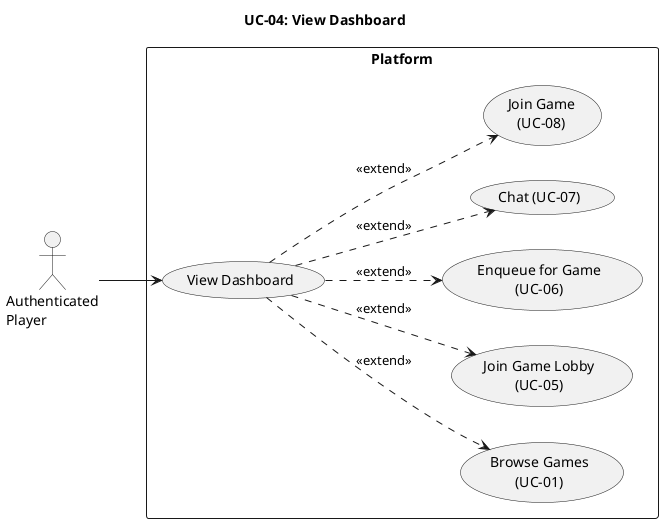

# UC-04: View Dashboard #

## Use Case Diagram ##

For use in [editor.plantuml.com](editor.plantuml.com), SVG also attached:

---

## Description ##

| Field | Detail |
|---|---|
| **Use Case ID** | UC-04 |
| **Primary Actor** | Authenticated Player |
| **Goal** | Access authenticated options (lobby, queue, chat, join game when ready) |
| **Preconditions** | Player is authenticated |
| **Trigger** | Player logs in or navigates to the dashboard |
| **Postconditions** | None |

**Main Success Scenario:**

1. System retrieves the player's current status (idle, in lobby, in queue, game ready).
2. System displays the dashboard with available options:
   - Browse games
   - Join a game lobby
   - Enqueue for a game
   - Open chat
   - Join game (if a game is ready)
3. System displays any pending notifications (game invites, queue updates).
4. Player selects an action, triggering the corresponding use case.

**Alternative Flows:**

- **1a.** Player has "game ready" status → System highlights the "Join Game" option prominently.
- **1b.** Player is currently in a queue → System shows queue status and a "Leave Queue" option.
- **1c.** Player is in a lobby → System shows lobby info and a "Return to Lobby" option.
