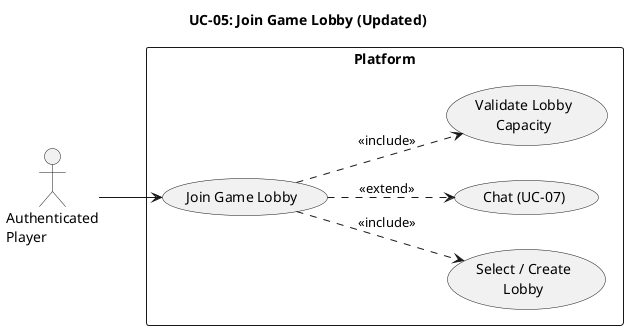

# UC-05: Join Game Lobby (Updated) #

## Quality Feedback Reference: UC-3 ##

> "You may want to define whether there is a cap or management strategy for the number of game lobbies just like number of players in the game."

**Changes:** Added lobby capacity limits, maximum lobby count per game type, and idle lobby cleanup.

## Use Case Diagram ##

For use in [editor.plantuml.com](editor.plantuml.com):

---

## Description ##

| Field | Detail |
|---|---|
| **Use Case ID** | UC-05 |
| **Primary Actor** | Authenticated Player |
| **Goal** | Enter a lobby for a specific game to coordinate and chat |
| **Preconditions** | Player is authenticated; target game exists |
| **Trigger** | Player selects a game and chooses "Join lobby" |
| **Postconditions** | Player is in the selected lobby |

**Main Success Scenario:**

1. System displays available lobbies for the selected game, including:
   - Lobby name/ID
   - Current player count / maximum player capacity
   - Current lobby count / maximum lobby limit for this game type
2. Player selects a lobby (or is auto-assigned to one with available capacity).
3. System validates that the selected lobby has not reached its player capacity.
4. System adds the player to the lobby.
5. System displays lobby participants and lobby chat.
6. Player can send/receive messages (extends to UC-07: Chat).

**Alternative Flows:**

- **1a.** No open lobbies AND lobby limit not reached → System creates a new lobby and places the player in it.
- **1b.** No open lobbies AND lobby limit reached → System displays "All lobbies are full. Please wait for a spot to open or try a different game." *(NEW)*
- **2a.** Selected lobby is full → System notifies the player and suggests other lobbies with available capacity, or creates a new one if the lobby limit allows. *(UPDATED)*
- **5a.** Idle lobby cleanup → System automatically removes lobbies that have been empty (zero players) for more than a configurable duration (e.g., 5 minutes). *(NEW)*

**Exceptions:**

- **3a.** Player is already in another lobby → System prompts the player to leave the current lobby first.
- **3b.** Lobby was filled by another player between selection and join → System displays "Lobby is now full" and returns to the lobby list. *(NEW)*

---

## Lobby Capacity Configuration ##

| Parameter | Description | Default |
|---|---|---|
| `MAX_PLAYERS_PER_LOBBY` | Maximum number of players allowed in a single lobby | Game-dependent (e.g., 2 for Tic-Tac-Toe, 2 for Checkers, 2 for Connect 4) |
| `MAX_LOBBIES_PER_GAME` | Maximum number of concurrent lobbies for a single game type | 50 |
| `IDLE_LOBBY_TIMEOUT` | Duration after which an empty lobby is automatically removed | 300 seconds (5 minutes) |

These values are configurable per game type and can be adjusted by the Platform Core team based on server capacity.
