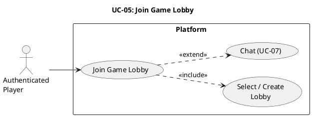

# UC-05: Join Game Lobby #

## Use Case Diagram ##

For use in [editor.plantuml.com](editor.plantuml.com), SVG also attached:

---

## Description ##

| Field | Detail |
|---|---|
| **Use Case ID** | UC-05 |
| **Primary Actor** | Authenticated Player |
| **Goal** | Enter a lobby for a specific game to coordinate and chat |
| **Preconditions** | Player is authenticated; target game exists |
| **Trigger** | Player selects a game and chooses "Join lobby" |
| **Postconditions** | Player is in the selected lobby |

**Main Success Scenario:**

1. System displays available lobbies for the selected game (or creates a new one if none exist).
2. Player selects a lobby (or is auto-assigned).
3. System adds the player to the lobby.
4. System displays lobby participants and lobby chat.
5. Player can send/receive messages (extends to UC-07: Chat).

**Alternative Flows:**

- **1a.** No open lobbies → System creates a new lobby and places the player in it.
- **2a.** Selected lobby is full → System notifies the player and suggests other lobbies or creates a new one.

**Exceptions:**

- **3a.** Player is already in another lobby → System prompts the player to leave the current lobby first.
