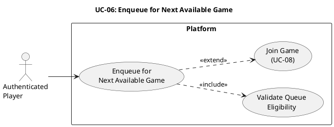

# UC-06: Enqueue for Next Available Game #

## Use Case Diagram ##

For use in [editor.plantuml.com](editor.plantuml.com), SVG also attached:

---

## Description ##

| Field | Detail |
|---|---|
| **Use Case ID** | UC-06 |
| **Primary Actor** | Authenticated Player |
| **Goal** | Wait to be matched/assigned into the next available game session |
| **Preconditions** | Player is authenticated; game supports queueing |
| **Trigger** | Player selects "Enqueue" from the dashboard (optionally choosing a game) |
| **Postconditions** | Player is either still queued or has a "game ready" status |

**Main Success Scenario:**

1. Player optionally selects a specific game type to queue for.
2. System validates that the player is not already in an active game or queue.
3. System places the player into the matchmaking queue.
4. System displays queue status (position, estimated wait time if applicable).
5. When a session is available, the system notifies the player that the game is ready.
6. Player proceeds to UC-08: Join Game.

**Alternative Flows:**

- **1a.** Player does not select a game → System queues for any available game.
- **4a.** Player chooses to leave the queue → System removes the player; returns to dashboard.

**Exceptions:**

- **2a.** Player is already in a queue → System informs the player and offers to leave the current queue.
- **2b.** Player is in an active game → System blocks enqueue and informs the player.
