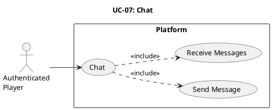

# UC-07: Chat #

## Use Case Diagram ##

For use in [editor.plantuml.com](editor.plantuml.com), SVG also attached:

---

## Description ##

| Field | Detail |
|---|---|
| **Use Case ID** | UC-07 |
| **Primary Actor** | Authenticated Player |
| **Goal** | Send/receive chat messages (in a lobby or global context) |
| **Preconditions** | Player is authenticated |
| **Trigger** | Player opens the chat UI (from dashboard or lobby) |
| **Postconditions** | Chat history updated |

**Main Success Scenario:**

1. System displays the chat interface for the current context (lobby chat or global chat).
2. System loads recent chat history.
3. Player enters a message and submits.
4. System broadcasts the message to the appropriate channel/context.
5. Player receives messages from other participants in real time.

**Alternative Flows:**

- **1a.** Player is in a lobby → Chat defaults to the lobby channel.
- **1b.** Player is on the dashboard → Chat defaults to the global/general channel.
- **3a.** Player sends an empty message → System ignores the submission.

**Exceptions:**

- **4a.** Message delivery fails → System displays an error indicator next to the message.
