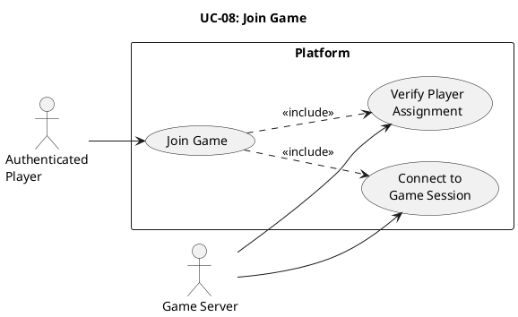

# UC-08: Join Game #

## Use Case Diagram ##

For use in [editor.plantuml.com](editor.plantuml.com), SVG also attached:

---

## Description ##

| Field | Detail |
|---|---|
| **Use Case ID** | UC-08 |
| **Primary Actor** | Authenticated Player |
| **Secondary Actor** | Game Server |
| **Goal** | Enter the active game session once it starts |
| **Preconditions** | Player is authenticated; a game session is available for the player (invited/matched/ready) |
| **Trigger** | Player selects "Join game" after being notified or seeing "game ready" |
| **Postconditions** | Player is in an active game session |

**Main Success Scenario:**

1. System verifies the player is assigned to the session.
2. System connects the player to the game session.
3. System loads the current game state.
4. System displays the game board/interface.
5. Player begins playing (further interactions handled by game-specific use cases).

**Alternative Flows:**

- **1a.** Player was notified via matchmaking (UC-06) → Session assignment already confirmed; proceed to step 2.
- **1b.** Player was in a lobby (UC-05) → System confirms lobby-to-session transition; proceed to step 2.

**Exceptions:**

- **1c.** Player is not assigned to the session → System displays "You are not part of this game session".
- **2a.** Game session no longer exists (expired/cancelled) → System informs the player and returns to dashboard.
- **2b.** Game session is already full → System informs the player and returns to dashboard.
