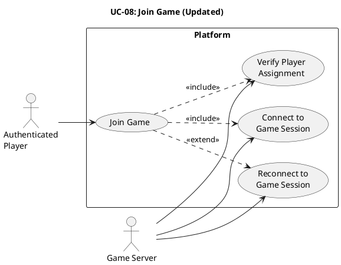

# UC-08: Join Game (Updated) #

## Quality Feedback Reference: S-1 ##

> "Consider adding a reconnection state to handle cases where a player disconnects mid-game and later reconnects."

**Changes:** Added reconnection alternative flow (1c/1d) for players who disconnected mid-game.

## Use Case Diagram ##

For use in [editor.plantuml.com](editor.plantuml.com):

---

## Description ##

| Field | Detail |
|---|---|
| **Use Case ID** | UC-08 |
| **Primary Actor** | Authenticated Player |
| **Secondary Actor** | Game Server |
| **Goal** | Enter the active game session once it starts, or reconnect to an ongoing session after disconnection |
| **Preconditions** | Player is authenticated; a game session is available for the player (invited/matched/ready) OR player has a pending reconnection to an active session |
| **Trigger** | Player selects "Join game" after being notified or seeing "game ready"; OR player logs back in / reconnects after a disconnection |
| **Postconditions** | Player is in an active game session |

**Main Success Scenario:**

1. System verifies the player is assigned to the session.
2. System connects the player to the game session.
3. System loads the current game state.
4. System displays the game board/interface.
5. Player begins playing (further interactions handled by game-specific use cases).

**Alternative Flows:**

- **1a.** Player was notified via matchmaking (UC-06) → Session assignment already confirmed; proceed to step 2.
- **1b.** Player was in a lobby (UC-05) → System confirms lobby-to-session transition; proceed to step 2.
- **1c.** Player is reconnecting after disconnection *(NEW — S-1)*:
  1. System detects that the player has an active session in `Disconnected` state.
  2. System verifies the reconnection timeout has not expired.
  3. System restores the player's connection to the game session.
  4. System loads the current game state (which may have advanced if the opponent moved during disconnection).
  5. System displays the game board with the current state.
  6. Player resumes playing from their restored state (`YourTurn` or `WaitingForTurn`).
- **1d.** Player reconnects but timeout has expired *(NEW — S-1)*:
  1. System detects the player had an active session but the reconnection timeout has elapsed.
  2. The session was already resolved as a forfeit.
  3. System displays "Your game session has ended due to disconnection timeout."
  4. System navigates to UC-14 (View Game Results) showing the forfeit result.

**Exceptions:**

- **1c.** Player is not assigned to the session → System displays "You are not part of this game session".
- **2a.** Game session no longer exists (expired/cancelled) → System informs the player and returns to dashboard.
- **2b.** Game session is already full → System informs the player and returns to dashboard.
- **3a.** (Reconnection) Game state fails to load → System displays "Unable to restore game session" and returns to dashboard. *(NEW)*
