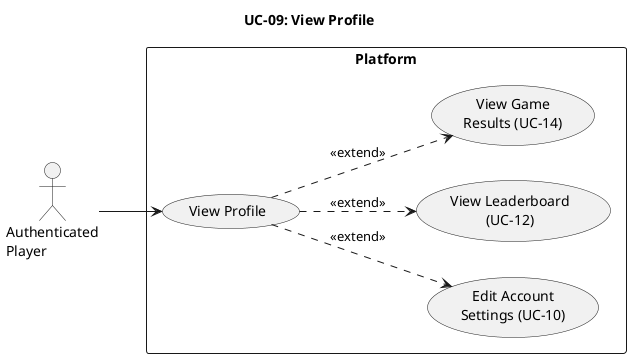

# UC-09: View Profile #

## Use Case Diagram ##

For use in [editor.plantuml.com](editor.plantuml.com), SVG also attached:

---

## Description ##

| Field | Detail |
|---|---|
| **Use Case ID** | UC-09 |
| **Primary Actor** | Authenticated Player |
| **Goal** | View personal profile, account details, and gameplay statistics |
| **Preconditions** | Player is authenticated |
| **Trigger** | Player selects "View Profile" from dashboard or navigation |
| **Postconditions** | None (read-only) |

**Main Success Scenario:**

1. Player selects "View Profile".
2. System retrieves the player's profile data.
3. System displays profile information:
   - Username and account details
   - Overall game stats (wins, losses, draws, games played)
   - Per-game stats (e.g., Connect 4, Tic-Tac-Toe, Checkers)
   - Rank/MMR summary
4. Player reviews profile information.
5. Player optionally chooses a follow-up action (edit settings, view leaderboard, or view recent game results).

**Alternative Flows:**

- **3a.** Player has no game history yet → System displays empty/default stats with a "No games played yet" message.
- **5a.** Player selects "Edit Account Settings" → System navigates to UC-10.
- **5b.** Player selects "View Leaderboard" → System navigates to UC-12.
- **5c.** Player selects a recent match entry → System navigates to UC-14.

**Exceptions:**

- **2a.** Profile service/data retrieval fails → System displays "Unable to load profile, please try again."
- **2b.** Session is no longer valid → System redirects player to UC-03 (Log In).

