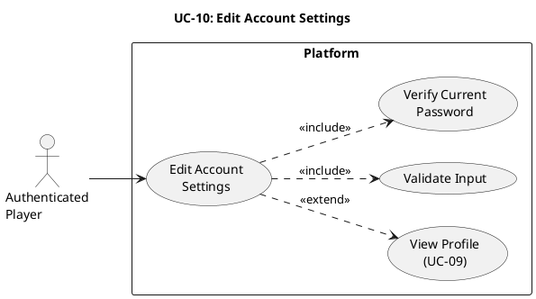

# UC-10: Edit Account Settings #

## Use Case Diagram ##

For use in [editor.plantuml.com](editor.plantuml.com), SVG also attached:

---

## Description ##

| Field | Detail |
|---|---|
| **Use Case ID** | UC-10 |
| **Primary Actor** | Authenticated Player |
| **Goal** | Update account information (username, email, and/or password) |
| **Preconditions** | Player is authenticated |
| **Trigger** | Player selects "Edit Account Settings" from profile or navigation |
| **Postconditions** | Updated account fields are persisted |

**Main Success Scenario:**

1. Player opens account settings.
2. System displays editable account fields (username, email, password controls).
3. Player modifies one or more fields.
4. System validates input (format, required fields, uniqueness constraints as applicable).
5. For password change, system verifies current password.
6. System persists valid changes.
7. System confirms success and returns to profile view (UC-09).

**Alternative Flows:**

- **3a.** Player updates only username or email → System validates and saves only changed fields.
- **3b.** Player updates password only → System requires current password before saving.
- **7a.** Player chooses to stay on settings page after save → System remains on UC-10 with success message.

**Exceptions:**

- **4a.** Validation fails (e.g., invalid email format) → System highlights invalid fields and requests correction.
- **4b.** Username/email already in use → System displays conflict message and does not persist changes.
- **5a.** Current password is incorrect → Password update is rejected; other unchanged fields remain unaffected.
- **6a.** Persistence fails (database/service unavailable) → System displays "Unable to save changes, please try again."

