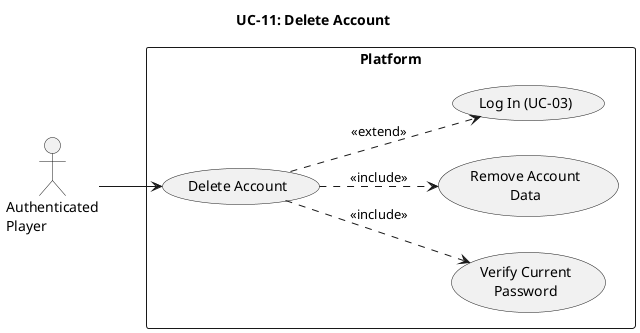

# UC-11: Delete Account #

## Use Case Diagram ##

For use in [editor.plantuml.com](editor.plantuml.com), SVG also attached:

---

## Description ##

| Field | Detail |
|---|---|
| **Use Case ID** | UC-11 |
| **Primary Actor** | Authenticated Player |
| **Goal** | Permanently delete the player account and associated account data |
| **Preconditions** | Player is authenticated |
| **Trigger** | Player selects "Delete Account" from account settings |
| **Postconditions** | Account is removed and the user session is terminated |

**Main Success Scenario:**

1. Player opens account settings and selects "Delete Account".
2. System displays a confirmation prompt that deletion is permanent.
3. Player confirms deletion intent.
4. System prompts for current password.
5. Player enters current password.
6. System verifies password validity.
7. System removes account records and associated profile credentials.
8. System logs the player out and clears session state.
9. System redirects to login/welcome (UC-03 entry point) with a deletion confirmation message.

**Alternative Flows:**

- **3a.** Player cancels at confirmation prompt → Deletion is aborted and user remains in account settings.
- **4a.** Policy requires second confirmation (e.g., type username) → System validates confirmation text before proceeding.
- **9a.** System redirects to public landing page instead of login screen based on product setting.

**Exceptions:**

- **6a.** Password verification fails → System displays "Current password is incorrect" and does not delete account.
- **7a.** Account deletion persistence fails → System displays "Unable to delete account, please try again."
- **8a.** Session cleanup partially fails → System invalidates server-side session and forces sign-out on next request.

