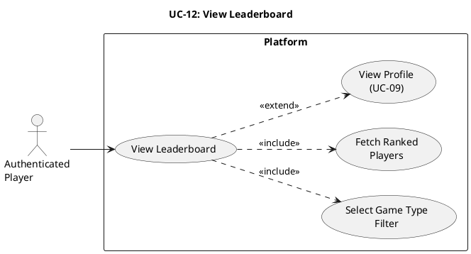

# UC-12: View Leaderboard #

## Use Case Diagram ##

For use in [editor.plantuml.com](editor.plantuml.com), SVG also attached:

---

## Description ##

| Field | Detail |
|---|---|
| **Use Case ID** | UC-12 |
| **Primary Actor** | Authenticated Player |
| **Goal** | View ranked players and compare standing across game modes |
| **Preconditions** | Player is authenticated |
| **Trigger** | Player selects "Leaderboard" from dashboard, profile, or results screen |
| **Postconditions** | None (read-only) |

**Main Success Scenario:**

1. Player opens the leaderboard view.
2. System displays available ranking filters (overall or per-game type).
3. Player selects a filter.
4. System retrieves ranking data for the selected filter.
5. System displays ordered leaderboard entries (rank, username, rating/MMR, relevant stats).
6. System highlights the current player's position if present in the loaded range.
7. Player reviews standings.

**Alternative Flows:**

- **2a.** Default filter is preselected (e.g., Overall) → System loads rankings immediately.
- **5a.** Player pages/scrolls for additional entries → System loads next range of leaderboard rows.
- **7a.** Player selects a listed player → System may navigate to public profile details (if enabled).
- **7b.** Player returns to prior context (dashboard/profile/results) without changing data.

**Exceptions:**

- **4a.** Leaderboard service temporarily unavailable → System displays "Leaderboard unavailable, please try again."
- **4b.** No ranked data for selected filter → System displays "No ranking data available yet."
- **6a.** Player has no ranking yet → System displays "You are currently unranked."

