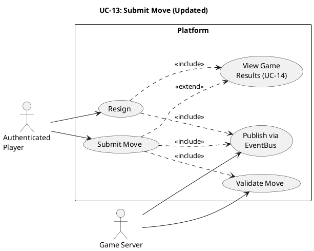

# UC-13: Submit Move (Updated) #

## Quality Feedback Reference: S-2, S-3, C-4 ##

- **S-2**: Added timeout exception for turn timer expiry
- **S-3**: Added resign alternative flow
- **C-4**: submitMove routes all updates through EventBus

## Use Case Diagram ##

For use in [editor.plantuml.com](editor.plantuml.com):

---

## Description ##

| Field | Detail |
|---|---|
| **Use Case ID** | UC-13 |
| **Primary Actor** | Authenticated Player |
| **Secondary Actor** | Game Server (GameSessionManager) |
| **Goal** | Make a move during an active game session |
| **Preconditions** | Player is authenticated; player is in an active game session; it is the player's turn |
| **Trigger** | Player performs a game action (clicks a board cell, selects a piece, etc.) |
| **Postconditions** | Game state is updated; turn passes to the next player or the game ends |

**Main Success Scenario:**

1. System displays the game board with the player's available actions (it is the player's turn — `YourTurn` state).
2. Player selects a move (e.g., places a piece, moves a checker).
3. System sends the move to `GameSessionManager.submitMove(sessionId, playerId, move)`.
4. GameSessionManager delegates to `GameEngine.validateMove(state, move)`.
5. Move is valid — GameSessionManager calls `GameEngine.applyMove(state, move)`.
6. GameSessionManager calls `GameEngine.evaluateEnd(state)` to check for win/draw.
7. Game is not over — GameSessionManager publishes `GameStateUpdate` event via **EventBus** (status: opponent's turn). *(C-4: all updates route through EventBus)*
8. GUI receives the event via EventBus subscription and updates the board display for all players.
9. Player's state transitions to `WaitingForTurn`.

**Alternative Flows:**

- **6a.** Game is over (win or draw) → GameSessionManager publishes `GameStateUpdate(gameOver)` via EventBus; triggers UC-14: View Game Results.
- **1b.** Player selects "Resign" → See **Resign flow** below. *(NEW — S-3)*

**Resign Flow:** *(NEW — S-3)*

1. Player selects "Resign" (available from both `YourTurn` and `WaitingForTurn` states).
2. System displays confirmation dialog ("Are you sure you want to resign? This will count as a loss.").
3. Player confirms.
4. GameSessionManager records the outcome as a loss for the resigning player.
5. GameSessionManager publishes `GameStateUpdate(gameOver, outcome=RESIGN)` via EventBus.
6. Triggers UC-14: View Game Results for both players.

- **3a.** Player cancels → Use case ends; game continues.

**Exceptions:**

- **4a.** Move is invalid → GameSessionManager publishes `GameStateUpdate` with error via EventBus; GUI displays "Invalid move" and keeps the player in `YourTurn` state to retry.
- **1a.** It is not the player's turn (`WaitingForTurn` state) → Input is disabled; player must wait for their turn notification.
- **3a.** Session no longer exists → System displays "Game session ended" and returns to dashboard.
- **1c.** Turn timer expires → GameSessionManager handles timeout based on game configuration: either auto-passes (transitions to `WaitingForTurn`) or auto-forfeits (triggers UC-14 with outcome=TIMEOUT). Published via EventBus. *(NEW — S-2)*
