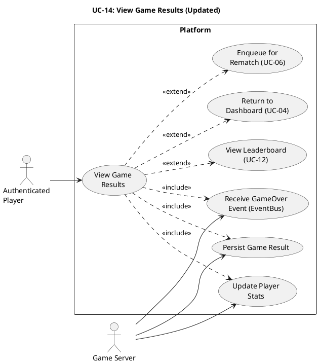

# UC-14: View Game Results (Updated) #

## Quality Feedback Reference: S-1, S-3, C-2, C-4, SD-3 ##

- **S-1**: Added reconnection result display (already existed as 2a, now explicit)
- **S-3**: Added RESIGN and TIMEOUT outcome types
- **C-2**: Clarified game-type stats update path via `Player.updateStats(...)`
- **C-4**: Updated `logGameResult` to accept `GameResult` object with full outcome details
- **SD-3**: Added retry logic for stats persistence failure

## Use Case Diagram ##

For use in [editor.plantuml.com](editor.plantuml.com):

---

## Description ##

| Field | Detail |
|---|---|
| **Use Case ID** | UC-14 |
| **Primary Actor** | Authenticated Player |
| **Secondary Actor** | Game Server (GameSessionManager, Leaderboard) |
| **Goal** | See the outcome of a completed game and updated stats |
| **Preconditions** | A game session the player was in has ended (`GameEnded` state) |
| **Trigger** | `GameStateUpdate(gameOver)` is received (automatic after UC-13 detects end condition, resign, or timeout) |
| **Postconditions** | Player stats and leaderboard are updated (or queued for reconciliation if persistence fails) |

**Main Success Scenario:**

1. System receives the `GameStateUpdate(gameOver)` event with the result payload via EventBus.
2. System displays the game results screen:
   - Winner / draw / forfeit / resign indication *(UPDATED — S-3: now includes resign and timeout outcomes)*
   - Final board state
   - Player stats changes (MMR gained/lost, new rank if applicable)
3. System calls `Leaderboard.logGameResult(result)` where `result` is a `GameResult` object containing `sessionId`, `winnerId`, `outcome` (WIN/DRAW/FORFEIT/RESIGN/TIMEOUT), and `playerStatDeltas`. *(UPDATED — C-4)*
4. System updates each player's `GameStats` via `Player.updateStats(gameType, result)`, which looks up the `Map<GameType, GameStats>` and calls the appropriate `recordWin/Loss/Tie` method. *(UPDATED — C-2)*
5. Player reviews results.
6. Player selects "Return to Dashboard" → System navigates to UC-04.

**Alternative Flows:**

- **2a.** Player was disconnected when game ended → Results are stored; when the player reconnects (UC-08 flow 1c/1d), the results screen is shown. *(UPDATED — S-1)*
- **2b.** Game ended due to resign → Results screen shows "Player X resigned" with the resigning player recorded as the loser. *(NEW — S-3)*
- **2c.** Game ended due to timeout → Results screen shows "Player X forfeited due to timeout" or "Player X disconnected." *(NEW — S-2/S-1)*
- **5a.** Player selects "Play Again" (if supported) → System enqueues the player for the same game type (UC-06).
- **5b.** Player selects "View Leaderboard" → System navigates to UC-12.
- **5c.** Player selects "Return to Dashboard" → System navigates to UC-04.

**Exceptions:**

- **3a.** Leaderboard service fails → System retries up to 3 times with exponential backoff (1s, 2s, 4s). If all retries fail, results are still displayed to the player with a warning indicator ("Stat updates may be delayed"); the failure is logged for manual reconciliation. *(UPDATED — SD-3)*
- **4a.** Player stats update fails → Same retry strategy as 3a; stats update is bundled with the leaderboard persistence retry. *(NEW — SD-3)*
