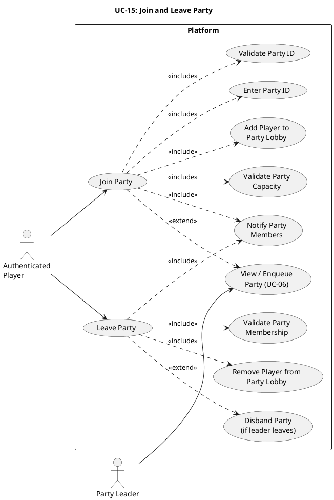

# UC-15: Create, Join, and Leave Party #

## Quality Feedback Reference: Party-1 ##

> "Add a leave-party path and define what happens when the party leader leaves."

**Changes:** Added `Leave Party` flow with membership validation, member notifications, and leader-leave disband/lead-transfer handling.

## Use Case Diagram ##

For use in [editor.plantuml.com](editor.plantuml.com):

---

## Description ##

| Field | Detail |
|---|---|
| **Use Case ID** | UC-15 |
| **Primary Actor** | Authenticated Player |
| **Secondary Actor** | Party Leader |
| **Goal** | Join an existing party and leave a party safely while keeping party state consistent |
| **Preconditions** | Player is authenticated |
| **Trigger** | Player selects "Join Party" or "Leave Party" from party controls |
| **Postconditions** | Player is added to or removed from the party; party state is synchronized for all members |

---

### Main Success Scenario (Join Party) ###

1. Player selects "Join Party".
2. System prompts for a party ID.
3. Player enters the party ID.
4. System validates the party ID and confirms the party exists.
5. System validates that the party has available capacity.
6. System adds the player to the party lobby.
7. System notifies all party members that the new player joined.
8. System displays the updated party roster.

**Alternative Flows:**

- **4a.** Party ID does not exist → System displays "Party not found".
- **5a.** Party is full → System displays "Party is full".
- **5b.** Player is already in another party → System displays "Leave your current party first".
- **8a.** Party leader starts queue from party view → Extends to UC-06.

---

### Main Success Scenario (Leave Party) ###

1. Player selects "Leave Party".
2. System validates that the player is currently a party member.
3. System removes the player from the party lobby.
4. System notifies remaining party members of the leave event.
5. System displays updated party state to all impacted users.

**Alternative Flows:**

- **2a.** Player is not in a party → System displays "You are not currently in a party".
- **3a.** Leaving player is the party leader and at least one member remains → System transfers leadership to another member.
- **3b.** Leaving player is the party leader and no members remain → System disbands the party.

---

### Exceptions ###

- **4a.** (Join) Party state update fails after validation → System rolls back membership change and displays "Unable to join party, please try again".
- **3a.** (Leave) Removal write fails → System displays "Unable to leave party, please try again".
- **4b.** (Leave) Member notification fails → Leave still succeeds; notification is retried asynchronously.