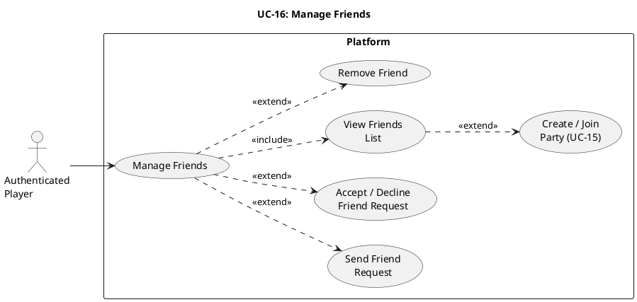

# UC-16: Manage Friends #

## Quality Feedback Reference: UC-2 ##

> "It may be beneficial to include use cases for accepting/declining friend requests and managing friends."

## Use Case Diagram ##

For use in [editor.plantuml.com](editor.plantuml.com):

---

## Description ##

| Field | Detail |
|---|---|
| **Use Case ID** | UC-16 |
| **Primary Actor** | Authenticated Player |
| **Goal** | Manage friend relationships: send requests, accept/decline, view list, remove |
| **Preconditions** | Player is authenticated |
| **Trigger** | Player selects "Friends" from the dashboard or navigation menu |
| **Postconditions** | Friend list updated accordingly |

---

### Main Success Scenario (View Friends List): ###

1. System displays the Friends panel showing:
   - Current friends (online/offline status)
   - Pending outgoing friend requests
   - Pending incoming friend requests
2. Player reviews their friends list.
3. Player selects an action (see Extend flows below).

---

### Extend: Send Friend Request ###

1. Player selects "Add Friend".
2. System displays a search/input field for username.
3. Player enters a username and submits.
4. System validates the target player exists.
5. System checks that a request is not already pending and that they are not already friends.
6. System creates a friend request and notifies the target player.
7. System displays confirmation ("Friend request sent").

**Alternative Flows:**

- **4a.** Username not found → System displays "Player not found".
- **5a.** Request already pending → System displays "Friend request already sent".
- **5b.** Already friends → System displays "You are already friends with this player".
- **5c.** Player tries to add themselves → System displays "You cannot add yourself as a friend".

---

### Extend: Accept / Decline Friend Request ###

1. Player views incoming friend requests (displayed in the Friends panel).
2. Player selects "Accept" or "Decline" on a specific request.
3. **Accept path:**
   - System adds both players to each other's friend lists.
   - System notifies the requesting player that their request was accepted.
   - System displays the new friend in the friends list.
4. **Decline path:**
   - System removes the friend request.
   - No notification is sent to the requesting player.

**Alternative Flows:**

- **1a.** No pending requests → System displays "No pending friend requests".

---

### Extend: Remove Friend ###

1. Player selects a friend from the friends list.
2. Player selects "Remove Friend".
3. System displays confirmation dialog ("Are you sure you want to remove this friend?").
4. Player confirms.
5. System removes both players from each other's friend lists.
6. System displays updated friends list.

**Alternative Flows:**

- **4a.** Player cancels → Use case ends; friends list unchanged.

---

### Integration Points ###

| Use Case | Integration |
|---|---|
| **UC-04: View Dashboard** | Friends panel accessible from dashboard navigation. Notification badge shows pending friend request count. |
| **UC-05: Join Game Lobby** | Friends list shown in lobby; players can see which friends are in the same lobby. |
| **UC-15: Create / Join Party** | "Invite to Party" action available on friends in the friends list. Party invitations can be sent directly to friends. |
| **UC-06: Enqueue for Game** | Friends who are online and idle can be invited to queue together. |

---

### Exceptions ###

- **6a.** (Send Request) Notification delivery fails → Request is still stored; notification retried on next poll.
- **3a.** (Accept) Friend list write fails → System displays "Unable to accept request, please try again".
