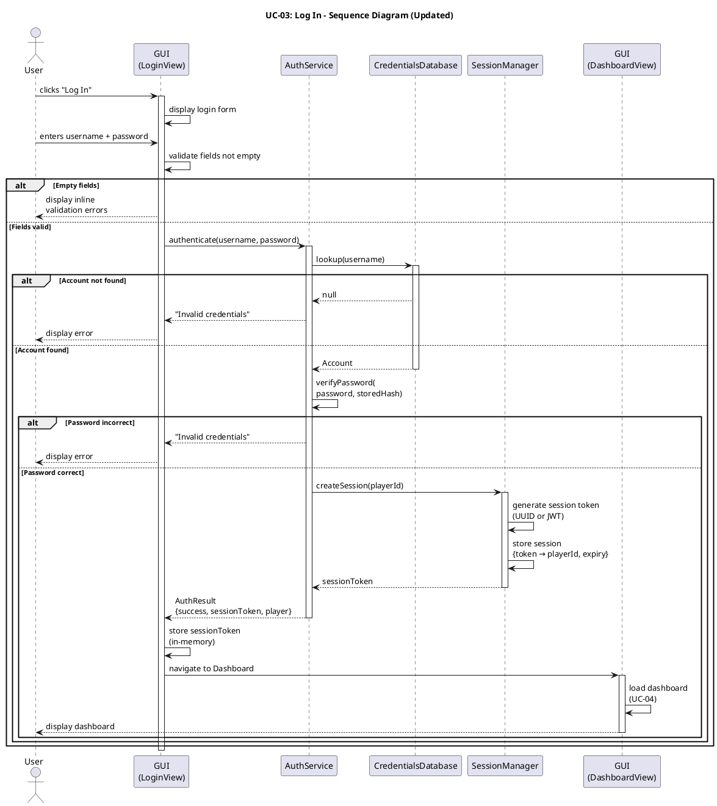

# Sequence Diagram: Log In (Updated) #

## Quality Feedback Reference: SD-1 ##

> "It is recommended to explicitly model session token creation in the login sequence for clarity."

**Changes:** Added explicit session token creation step between password verification and dashboard navigation.

## Sequence Diagram ##

For use in [editor.plantuml.com](editor.plantuml.com):

---

## Session Token Details ##

| Aspect | Detail |
|---|---|
| **Token format** | UUID string (stub) or JWT (production) |
| **Storage (client)** | In-memory variable (`currentSessionToken`). For stub: simple field on the GUI controller. |
| **Storage (server)** | `SessionManager` maintains a `Map<String, SessionInfo>` where `SessionInfo` holds `playerId`, `createdAt`, and `expiresAt`. |
| **Lifetime** | Configurable; default 24 hours for stub. |
| **Usage** | All subsequent authenticated requests include the token. `SessionManager.validateSession(token)` is called to verify. |
| **Invalidation** | Token is removed on logout (AUTH-04) or expiry. |

## Interaction with Other Use Cases ##

| Use Case | How Session Token Is Used |
|---|---|
| **AUTH-04: Log Out** | Calls `SessionManager.invalidateSession(token)` to clear the session. |
| **UC-04 – UC-15** | Each authenticated request passes the token; `SessionManager.validateSession(token)` verifies the player is authenticated before proceeding. |
| **AUTH-01: Register** | If auto-login is enabled, registration also calls `SessionManager.createSession()` to issue a token. |
