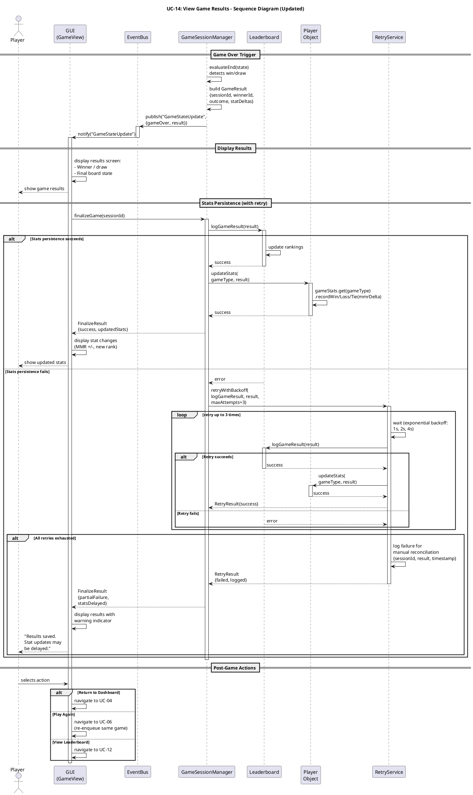

# Sequence Diagram: View Game Results / End Game (Updated) #

## Quality Feedback Reference: SD-3 ##

> "It may be useful to include handling or retry logic in case stats persistence fails during game finalization."

**Changes:** Added alt/opt fragment with retry logic (exponential backoff, up to 3 attempts) for stats persistence, with fallback to logging for manual reconciliation.

## Sequence Diagram ##

For use in [editor.plantuml.com](editor.plantuml.com):

---

## Retry Strategy Details ##

| Parameter | Value | Notes |
|---|---|---|
| **Max retry attempts** | 3 | Total of 4 attempts including the initial call |
| **Backoff strategy** | Exponential | 1s → 2s → 4s delay between retries |
| **Scope** | `logGameResult()` and `updateStats()` | Both operations are retried together |
| **On success (any attempt)** | Normal flow resumes | Player sees updated stats as usual |
| **On total failure** | Log for reconciliation | Failure record includes: sessionId, full GameResult payload, timestamp, number of attempts, last error |
| **Player experience** | Warning indicator on results screen | Player still sees game outcome (win/loss/draw) but stats show "update pending" |

## Reconciliation Process ##

When all retries fail, the system logs a reconciliation record:

| Field | Description |
|---|---|
| `sessionId` | The game session that completed |
| `result` | Full `GameResult` object (winner, outcome, stat deltas) |
| `failedAt` | Timestamp of final failure |
| `attempts` | Number of retry attempts made |
| `lastError` | Error message from final attempt |
| `status` | `PENDING_RECONCILIATION` |

A background job or manual admin process picks up pending reconciliation records and applies them when the Leaderboard service is available again. This aligns with UC-14 exception 3a: "stat persistence is retried or logged for manual reconciliation."
